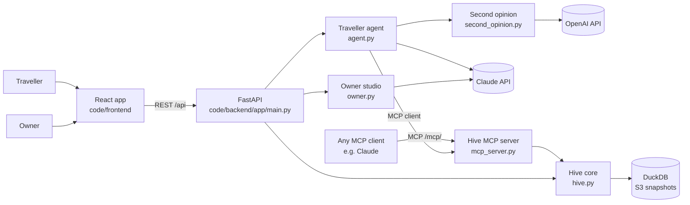

# Architecture

One FastAPI backend serves the web app over REST and agents over MCP. Both read the same signed Hive cards in
DuckDB. Claude is called only by the booking agent and for owner edits; OpenAI, if a key is set, only for the
second opinion on a held booking.

## Modules (`code/backend/app`)

| File | Responsibility |
| --- | --- |
| `hive.py` | Hive cards, Ed25519 signing and verification, attestations, discovery and ranking, availability, booking with signed receipts, proof-of-stay reviews, missed demand and the city demand map |
| `hive_seed.py` | Six fictional Basel businesses (five hotels, one café) with distances and attestations |
| `mcp_server.py` | The MCP server agents connect to |
| `agent.py` | The traveller agent: a Claude tool loop over MCP, plus a scripted planner when no key is set. Verifies every card's signature itself and holds `hive_book` until the traveller approves |
| `second_opinion.py` | A sceptic agent on another vendor (OpenAI) checks each held booking against the request and the signed card before the traveller is asked; a rule check answers without a key |
| `owner.py` | Plain-language card edits: proposal, diff, then re-sign and publish. Identity fields are locked |
| `simulate.py` | Simulated traveller searches for the demand map |
| `guard.py` | Owner and demo tokens, rate limits on calls that may reach Claude or OpenAI (see `SECURITY.md`) |
| `db.py`, `storage.py` | DuckDB connection, writes and S3 snapshot and restore |
| `llm.py`, `config.py` | Claude client with structured outputs and fallbacks; environment settings |

## Use cases (`code/backend/app/domains`)

The core knows cards, trust, events and bookings. A use case adds a card kind and its own MCP tools:

| Domain | Card kind | Tools | Where |
| --- | --- | --- | --- |
| Stays | `hotel`, `cafe` | `hive_*` | `mcp_server.py` (the first domain, kept in place) |
| HR (starter) | `person` | `hr_find_people`, `hr_request_intro` | `domains/hr.py` |

Each domain module has a `register(server)` function and is listed in `domains.DOMAINS`. How to add one:
[CONTRIBUTING.md](../CONTRIBUTING.md#add-a-use-case).

## Frontend (`code/frontend/src`)

| File | Responsibility |
| --- | --- |
| `api.ts` | Typed client for the REST API |
| `pages/TravellerAgent.tsx`, `components/AgentTrace.tsx` | The traveller's chat, the agent-to-agent trace and the approval step |
| `pages/OwnerStudio.tsx` | Plain-language edits, diff, sign and publish, missed demand |
| `pages/CardPage.tsx` | The human view of a card, direct booking and the tamper test |
| `pages/DemandMap.tsx` | What Basel asked for that nobody offers |
| `components/TrustBadge.tsx`, `components/B6Bee.tsx` | Trust chips; the footer easter egg |

## MCP tools (`/mcp/`, Streamable HTTP)

| Tool | What it does |
| --- | --- |
| `hive_discover` | Search with hard constraints (features, max price, near, dates, guests). Returns ranked matches with a score breakdown, and every excluded business with why |
| `hive_get_card` | The full signed card with trust information |
| `hive_check_availability` | Free units and totals for given dates |
| `hive_book` | Book a unit; returns a signed receipt |
| `hive_cancel` | Cancel with the receipt |
| `hive_review` | Leave a review; only valid with an unused booking receipt |
| `hr_find_people` | Find person cards by skills (and location); public fields only, with reasons for who was left out |
| `hr_request_intro` | Ask to meet a person; recorded for them, nothing shared until they consent |

Agents can find the endpoint from `/.well-known/hive.json`.

## REST API (for the web app)

`GET /api/health` · `GET /api/hive/cards[/{id}]` · `GET /api/hive/cards/{id}/availability` ·
`POST /api/hive/cards/{id}/book` · `POST /api/hive/reviews` · `POST /api/hive/verify` · `GET /api/hive/demand` ·
`POST /api/demo/simulate` · `POST /api/demo/reset` · `POST /api/agent` · `POST /api/agent/approve` · `GET /api/owner/{id}` · `POST /api/owner/{id}/propose` ·
`POST /api/owner/{id}/publish`

The contract lives in `code/backend/app/main.py`; change an endpoint in one PR so the frontend follows.

## Trust by design

- **Signatures.** Each card version is signed over canonical JSON (sorted keys, compact separators) with the
  owner's Ed25519 key. Agents verify client-side; the card page has a live tamper test.
- **Attestations.** Third parties sign single claims, shown as "dog-friendly verified".
- **Receipts.** A booking returns `base64url(body).signature`. A review needs one, once.
- **Transparent ranking.** No paid placement; the score breakdown and exclusion reasons are part of the response.
- **Missed demand.** Every exclusion and every search is logged; owners see what they were turned away for, the
  city sees what nobody offers.
- **Prompt safety.** Card text is treated as data in the agent's prompt, never as instructions.
- **Human in the loop.** The agent holds `hive_book` until the traveller approves (`POST /api/agent/approve`).
- **Abuse limits.** Owner edits can require a token, Claude calls are rate-limited, all input is bounded.
  Details and known limits: [SECURITY.md](../SECURITY.md).

## Stack and cost

Python 3.12, FastAPI, DuckDB 2, MCP Python SDK 2, Anthropic SDK; React 18, Vite, TypeScript.
The booking agent uses `claude-opus-5-5` at low effort with cached tool definitions; owner edits use
`claude-haiku-5-5`. Override with `CLAUDE_MODEL` and `CLAUDE_FAST_MODEL`; `AGENT_MAX_TURNS` caps each run. This
stretches the USD 75 demo key. Without a key everything still runs offline.

## Known limits

- The server holds each owner's signing key (the vision is owner-held keys).
- DuckDB on local disk with S3 snapshots pins the backend to one instance. Fine for a demo.
- No real payments; restaurant table booking is not built yet.
