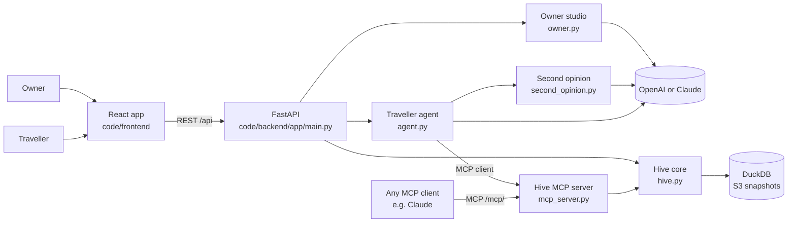

# Architecture

One FastAPI backend serves the web app over REST and agents over MCP. Both read the same signed Hive cards in
DuckDB. A model (OpenAI by default, Claude as an alternative, see `LLM_PROVIDER`) is called only by the booking
agent, for owner edits and for the second opinion on a held booking. Without a key, offline paths do all three.

## Modules (`code/backend/app`)

| File | Responsibility |
| --- | --- |
| `hive.py` | Hive cards, Ed25519 signing and verification, attestations, discovery and ranking, availability, booking with signed receipts, proof-of-stay reviews, missed demand and the city demand map |
| `hive_seed.py` | Six fictional Basel businesses (five hotels, one café) with distances and attestations |
| `mcp_server.py` | The MCP server agents connect to |
| `agent.py` | The traveller agent: an OpenAI or Claude tool loop over MCP, plus a scripted planner when no key is set. Verifies every card's signature itself and holds `hive_book` until the traveller approves |
| `injection.py` | The guard on every tool result: text that addresses agents (EN, DE, FR, IT rules) is withheld before the agent reads it and reported in the trace |
| `mirror.py` | Demo only: an unverified MCP source serving a manipulated copy of Muensterhof's card, for the stress test in chapter 1 |
| `second_opinion.py` | The verifier: a separate agent (OpenAI) checks each held booking against the request and the signed card before the traveller is asked; a rule check answers without a key |
| `critic.py` | The critic: always argues for the strongest alternative to the pick from the Hive's open ranking and concedes only when the pick ranks higher. With the verifier it sets `consensus` on the agent's answer. No model call |
| `owner.py` | Plain-language card edits: proposal, diff, then re-sign and publish. Identity fields are locked. Without a key, a rule-based edit understands add, remove and room prices in EN, DE, FR and IT and returns `summary_items` the studio words in the page's language |
| `rulesets.py` | Signed rulesets a person chooses per request (e.g. "Dogs, verified" by a fictional dog owners' club). They can only narrow a search, never boost; the answer names the ruleset, its author and what it changed. Authors' keys are in `/.well-known/hive.json` under `ruleset_keys` |
| `waiting.py` | Standing requests: an agent waits anonymously when nothing fits; the owner sees counts and budgets per missing change; a published card that now fits sends each waiting agent an offer signed with the business's key |
| `replies.py` | What the backend writes itself (offline planner, rules-off demo, approval, rule-check second opinion) in EN, DE, FR and IT; the language comes from the app's `Accept-Language` header, and model runs are told to answer in it |
| `simulate.py` | Simulated traveller searches for the demand map |
| `guard.py` | Owner and demo tokens, rate limits on calls that may reach Claude or OpenAI (see `SECURITY.md`) |
| `db.py`, `storage.py` | DuckDB connection, writes and S3 snapshot and restore |
| `llm.py`, `config.py` | Structured-output calls on OpenAI or Claude; provider choice and environment settings |

## Use cases (`code/backend/app/domains`)

The core knows cards, trust, events and bookings. A use case adds a card kind and its own MCP tools:

| Domain | Card kind | Tools | Where |
| --- | --- | --- | --- |
| Stays | `hotel`, `cafe` | `hive_*` | `mcp_server.py` (the first domain, kept in place) |
| HR (starter) | `person` | `hr_find_people`, `hr_request_intro` | `domains/hr.py` |
| Explore | `adventure`, `service`, `industrial`, `software`, `event` | `explore_ask` | `domains/explore.py`, cards in `domains/examples.py` |
| Scout | any kind found on the web (`taxi`, ...) | `hive_scout` | `domains/scout.py`: web search, verifier, unclaimed cards `w-*` |

Each domain module has a `register(server)` function and is listed in `domains.DOMAINS`. How to add one:
[CONTRIBUTING.md](../CONTRIBUTING.md#add-a-use-case).

## Frontend (`code/frontend/src`)

| File | Responsibility |
| --- | --- |
| `api.ts` | Typed client for the REST API |
| `App.tsx`, `main.tsx` | The one page: a header with the two chapters, the AI status and the language switch |
| `pages/TravellerAgent.tsx` | The page itself: the traveller's brief, the approval step, the signed receipt and the next steps, questions about any business in the same chat (chapter 1), then the business's side (chapter 2) |
| `components/Chapter.tsx` | A chapter of the page: number, headline, lead and its anchor |
| `components/GroupChat.tsx` | The agent stage as a group chat: every MCP call and answer becomes a message from a named persona, paced by `lib/pace.ts`, with Replay and Skip |
| `components/TraceParts.tsx` | How each MCP call and answer reads in the chat (ranking ledger, signed card, availability) |
| `components/NextSteps.tsx`, `lib/next.ts` | After a booking: a calendar file, a nearby place from the Hive, the walk from Basel SBB, and the hotel's side further down. None of them books or pays |
| `components/Icon.tsx`, `components/Display.tsx` | Our icon set; headlines with one italic phrase |
| `panels/` | The parts of chapters 2 and 3, one file each; see [The page](#the-page) |
| `components/TrustBadge.tsx`, `components/B6Bee.tsx` | Trust status lines; the footer easter egg |
| `i18n/` | English, German, French and Italian strings, the language switch and browser-language detection |
| `lib/format.ts` | Swiss date, CHF and distance formatting per language |
| `**/*.test.ts(x)` | Vitest unit and component tests in jsdom, `api.ts` mocked (`npm test`) |
| `styles.css` | Design tokens and every component style; see [BRAND.md](BRAND.md) |

## The page

The app is one page (`App.tsx`, no router) that tells one story in two chapters, each with an anchor the header
jumps to: `#travel`, the agent network (a room or any business, one chat); `#business`, the business's
side of the same booking. Old links such as `/agent` load the same page. `tests/test_docs.py` fails when a second
page appears or when a panel in `code/frontend/src/panels` has no row here.

| Panel | Chapter | What a person does there |
| --- | --- | --- |
| `DemandPanel.tsx` | 2, business | The Demand map tab: what Basel asked for that nobody offers; simulates a busy week with `?demo` |
| `OwnerPanel.tsx` | 2, business | The whole business chapter: the change box in the brief; in the panel, the owner studio (the booking just made, what agents asked for, the diff, sign and publish, the new version live) and the demand map as a tab; the tamper test with `?demo` |

## MCP tools (`/mcp/`, Streamable HTTP)

| Tool | What it does |
| --- | --- |
| `hive_discover` | Search with hard constraints (features, max price, near, dates, guests), optionally under a ruleset the user chose. Returns ranked matches with a score breakdown, and every excluded business with why. People never show up here, only through the HR tools |
| `hive_rulesets` | The rulesets a user can choose, each signed by its author |
| `hive_get_card` | The full signed card with trust information |
| `hive_check_availability` | Free units and totals for given dates |
| `hive_book` | Book a unit; returns a signed receipt |
| `hive_what_was_promised` | With a receipt: the signed card version the booking was made against, and which fields changed since |
| `hive_cancel` | Cancel with the receipt |
| `hive_review` | Leave a review; only valid with an unused booking receipt |
| `hive_wait` | When nothing fits and the traveller wants to be told: leave an anonymous standing request; returns an id and a secret token |
| `hive_check_waiting` | Read a standing request with its token: status and any offers, each signed by the business (check with its pinned key) |
| `hr_find_people` | Find person cards by skills (and location); public fields only, with reasons for who was left out |
| `explore_ask` | Answer a question from the cards that cover it (none if nothing does, counted as demand; `clarify` names what a request still has to say, such as a taxi's route and time), with reasons for what was left out and the mood the person chose; an action comes back as needing the person's approval in the app |
| `hive_scout` | When no card answers: find real businesses on the public web (OpenAI web search, else OpenStreetMap), verify each against its own site, add the verified ones as unclaimed cards with source and checks |
| `hr_request_intro` | Ask to meet a person; recorded for them, nothing shared until they consent |

Agents can find the endpoint from `/.well-known/hive.json`.

## REST API

The web app's contract, in `code/backend/app/main.py`. Every running backend also serves it interactively at
`/docs` (Swagger UI) and as `/openapi.json`. Change an endpoint, `api.ts` and this table in one PR;
`tests/test_docs.py` fails when a served endpoint has no row here.

| Endpoint | What it does | Guard |
| --- | --- | --- |
| `GET /api/health` | Up, and which model provider the agents use (`openai`, `claude` or `mock`) | |
| `GET /.well-known/hive.json` | Discovery for agents: the MCP URL, policies, pinned `owner_keys` and `ruleset_keys` | |
| `GET /api/hive/cards` | All cards, optionally `?kind=` | |
| `GET /api/hive/cards/{card_id}` | One signed card by id or slug, with trust (signature, `valid_until`, `fresh`, attestations, reviews) | |
| `GET /api/hive/cards/{card_id}/availability` | Free units and totals for `check_in`, `check_out`, `guests` | |
| `POST /api/hive/cards/{card_id}/book` | A person's direct booking, for a business's own site; returns a signed receipt | |
| `POST /api/hive/reviews` | A proof-of-stay review; needs an unused booking receipt | |
| `POST /api/hive/verify` | Check a card as an agent would, against the owner's pinned key | |
| `POST /api/hive/demo/forge/{card_id}` | Tamper demo: a copy re-signed by a stranger, which must fail | rate limit |
| `GET /api/hive/demand` | The city demand map: what agents asked for, how often nobody could serve it | |
| `POST /api/demo/simulate` | Up to 200 simulated traveller searches for the demand map | rate limit |
| `POST /api/demo/reset` | Back to the seed cards, no bookings, no demand | `X-Demo-Token` |
| `POST /api/agent` | Run the traveller agent over MCP; a booking comes back held, as `pending`, with the verifier's `second_opinion`, the `critic` and `consensus` | model rate limit |
| `POST /api/agent/approve` | The traveller's yes: send the held booking, once | one-time hold |
| `POST /api/ask` | Ask the Hive about the example cards, with an optional mood; actions come back held | model rate limit |
| `POST /api/ask/scout` | No card answered: the scout finds, verifies and adds unclaimed cards from the public web, then asks again; the request counts as unserved demand | model rate limit |
| `POST /api/ask/approve` | The person's yes: hand the held action off to the business | one-time hold |
| `GET /api/owner/{card_id}` | Owner studio data for any card, unclaimed too: bookings, missed demand, waiting requests, and what agents did with the card in the last 7 days (`shown`, `read`, `checked`, `booked`, `explore_handoff`); guest names as initials without the token | `X-Owner-Token` for names |
| `POST /api/owner/{card_id}/propose` | The owner's words to a proposed card and a diff; nothing is published | `X-Owner-Token`, model rate limit |
| `POST /api/owner/{card_id}/publish` | Sign and publish the approved card as a new version; waiting agents get signed offers | `X-Owner-Token` |

Every request carries the app's language as `Accept-Language`; `/api/agent`, `/api/agent/approve` and the
second opinion answer in it.

Rulesets, standing requests and "what was promised" are agent features, so they are MCP tools only (see above).

## Trust by design

- **Signatures.** Each card version is signed over canonical JSON (sorted keys, compact separators) with the
  owner's Ed25519 key. Agents verify client-side; the owner studio has a live tamper test.
- **Expiry.** `publish` signs a `valid_until` into every version (`FRESH_DAYS`, 90); discovery leaves out an
  expired card with the reason, and `trust.fresh` says whether it still holds.
- **Attestations.** Third parties sign single claims, shown as "dog-friendly verified".
- **Receipts.** A booking returns `base64url(body).signature`. A review needs one, once. The receipt pins the card
  version and its digest; every signed version is kept, so the receipt can later show what was promised.
- **Offers.** An offer to a waiting agent has the same form, signed by the business; `hive.verify_statement` checks
  it against the pinned key. It holds no room: the agent still asks its human before `hive_book`.
- **Transparent ranking.** No paid placement; the score breakdown and exclusion reasons are part of the response.
- **Missed demand.** Every exclusion and every search is logged; owners see what they were turned away for, the
  city sees what nobody offers.
- **Prompt safety.** Card text is treated as data in the agent's prompt, never as instructions. A guard withholds
  text addressed to agents before the agent reads it, and the agent checks every card's signature itself. Try it with
  the stress test in chapter 1, or `POST /api/agent` with `"scenario": "injection"` (and `"rules": "off"` for the
  unguarded counterfactual, which is scripted and never books).
- **Human in the loop.** The agent holds `hive_book` until the traveller approves (`POST /api/agent/approve`).
- **Unclaimed cards.** A card with `provenance.verified_by_owner: false` was compiled from a public website and is
  signed by the Hive as compiler. `trust.claimed` is false, the UI and every answer say so, owner edits refuse it,
  and an approved action only hands the person off to the business's own site.
- **Chosen, not inferred.** The API takes an optional mood a person sets (the app no longer shows a picker); the
  answer echoes it with its effects. Only the mood and the cards asked about are counted, never the question text or who asked.
- **Abuse limits.** Owner edits can require a token, model calls are rate-limited, all input is bounded.
  Details and known limits: [SECURITY.md](../SECURITY.md).

## Stack and cost

Python 3.12, FastAPI, DuckDB 2, MCP Python SDK 2, Anthropic SDK; React 18, Vite, TypeScript.
The booking agent uses `claude-opus-5-5` at low effort with cached tool definitions; owner edits use
`claude-haiku-5-5`. Override with `CLAUDE_MODEL` and `CLAUDE_FAST_MODEL`; `AGENT_MAX_TURNS` caps each run. This
stretches the USD 75 demo key. Without a key everything still runs offline.

## Known limits

- The server holds each owner's signing key (the vision is owner-held keys).
- DuckDB on local disk with S3 snapshots pins the backend to one instance. Fine for a demo.
- No real payments; restaurant table booking is not built yet.
