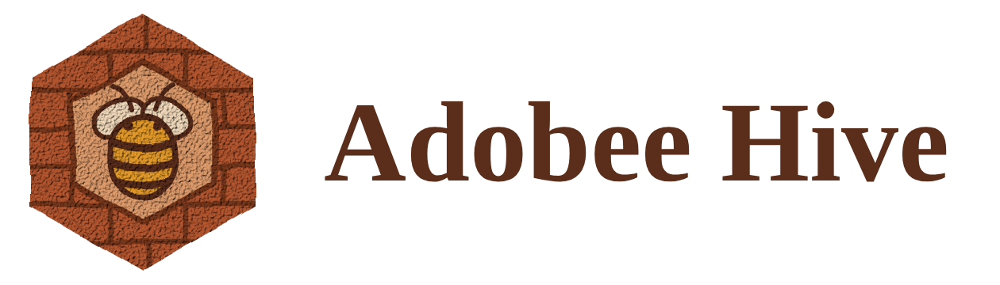
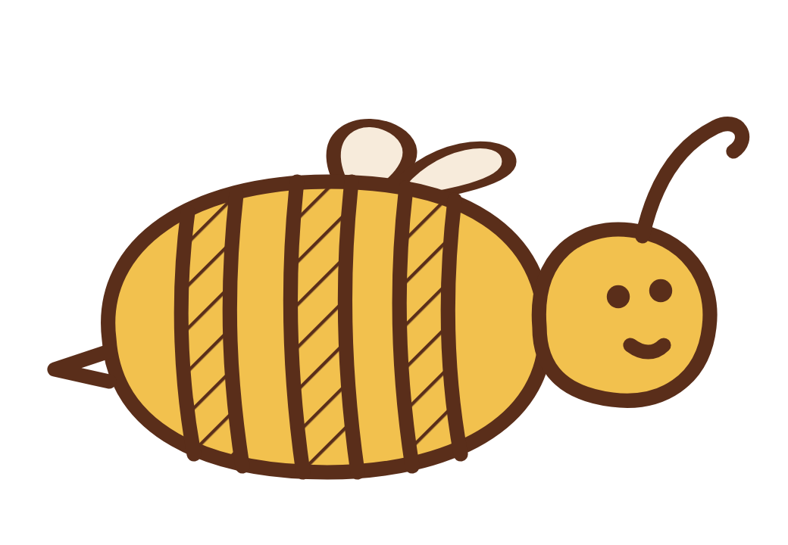

# Brand

## Name

**Adobee Hive**, one word Adobee: *adobe* is sun-dried clay brick, plus the *bee*. A hive is what bees build;
the Hive is what local businesses build together. Short form ABH.

## Logo

The bee in an open hexagon, drawn straight from the whiteboard sketch (`assets/whiteboard/name-and-logo-sketch.png`):
one clay line, no texture, so it reads at 16 px in a browser tab and on a phone. The hexagon is left open at the
corners like the marker sketch; the bee is two wings and a striped body. Clay because adobe means clay; a hexagon
because it is the honeycomb cell.

| File | Use |
| --- | --- |
| `code/frontend/public/brand/logo.svg` | The mark in clay, on paper |
| `code/frontend/public/brand/logo-light.svg` | The same mark in lit clay, on dark grounds (slides) |
| `code/frontend/public/brand/favicon.svg` | The mark itself; simple enough for tab size |
| `code/frontend/public/brand/wordmark.svg` | Mark plus name, self-contained |
| `assets/brand/*.png` | Exports for slides |

## Mascot: the B6 bee

Traced from the team's whiteboard drawing: striped, hatched body, two loop wings, curly antenna
(`code/frontend/public/brand/mascot.svg`). We are team **B6**: the bee is the B, and it carries the 6.

The easter egg is deliberately quiet. The bee sleeps in the footer next to "Team B6". Click it, or leave the app idle
for a minute, and it flies across the bottom of the page, dropping six little 6s. It never flies with
`prefers-reduced-motion`. The rest of the app stays serious.

## Positioning

| | |
| --- | --- |
| Product line | **The front door, signed.** |
| Promise | Adobee Hive gives every local business one signed card. Agents find it, verify it and book through it. The owner writes it in plain words, and nothing is booked until a person says yes. |
| Headline | The next guest is an agent. |
| Vision line (close of the pitch) | On GitHub you find projects to work on. On Adobee Hive, agents find businesses and people to work with. |

The four principles always carry these names, in this order, in the app, the readme and the pitch:

| Name | One line |
| --- | --- |
| Signed facts | Every card carries the owner's signature; agents verify it and turn away any altered copy. |
| Open ranking | Every result says why it won and why the others were left out. Placement cannot be bought. |
| Proof of stay | Only a signed booking receipt can leave a review. No stay, no review. |
| Your yes | Agents negotiate. People decide. Nothing is booked without your approval. |

And one idea beyond them: **missed demand**, "agents write the business plan".

## Voice

Short sentences. Facts before adjectives. Say what the product does, never how revolutionary it is: no
"seamless", "unlock", "empower", "AI-powered", no exclamation marks, no emoji. Privacy and ethics are stated as
plainly as features ("The Hive learns what was asked, never who asked"). One bee, used sparingly.

The interface ships in English, German, French and Italian, in the formal register (Sie, vous, Lei) with Swiss
spelling (ss, not ß), CHF and Swiss date formats. How to add a string: [CONTRIBUTING.md](../CONTRIBUTING.md).

## Colour and type

The page is **honey on white**: white surfaces, slate ink, one accent, honey. The agents talk on a dark stage,
where the same honey is lifted to `--accent-bright` so it reads at night. The accent marks what matters: eyebrows,
the italic turn in a headline, the chosen row, the moment you approve. Status is always a dot and a word, never a
pill. The logo and the bee keep their clay and yellow; they are drawings, not interface.

| Token | Value | Use |
| --- | --- | --- |
| `--bg` / `--surface` | `#ffffff` | Page and panels |
| `--surface-2` | `#f7f7f5` | Quiet tiles, hover on a row |
| `--ink` | `#16181d` | Text, primary buttons |
| `--ink-2` / `--ink-3` | `#5b606b` / `#6b7079` | Secondary and quiet text |
| `--line` | `#e6e7e3` | Hairlines |
| `--accent` | `#d99a1e` | Honey on white: focus rings, the chosen row, the diff |
| `--accent-ink` | `#8a5f0a` | Honey as text on white: eyebrows, prices |
| `--accent-bright` | `#f2b63c` | Honey on the dark agent stage: the seal, the pinned question |
| `--stage` | `#15171c` | The agent stage, where the agents talk |
| `--good` / `--bad` | `#1f7a4d` / `#b3261e` | A valid seal; rejected, only ever with the word that says so |

Type, bundled with their licence texts in `code/frontend/public/fonts/`:

- **Instrument Serif** for display: headlines at regular weight, tight leading, and one *italic phrase in honey*
  (write it as `*text*` in a string; `components/Display.tsx` sets it).
- The system sans (Inter where installed, else the platform's own) for text, UI and the brand name: no download,
  readable small. The whiteboard font Mannin stays in the fonts folder for the wordmark and slides.
- **Geist Mono** for tool names, signatures and the run's mode line.

Icons are our own (`components/Icon.tsx`): 24 px, 1.5 px stroke, drawn on the logo's hexagon. No icon font.

Imagery: lit honeycomb for slides (`assets/brand/hero-clay.svg`). The app itself has no photographs. No stock
photos, no people.

Personas on the agent stage are abstract hexagon avatars (`public/personas/`), one per voice: the guest, *Your agent*,
the Hive, the business, *the critic* (argues for the alternative), *the verifier* (checks the facts), *the mirror* (an unverified copy) and the owner. They are
fictional and drawn, never photos or generated faces.

Motion is purposeful only. The agent stage plays like a group chat: whoever speaks next glows and shows *is
thinking* (before a tool call or a judgement) or *is typing* (before a line), each message waits a beat timed to
its length (`lib/pace.ts`), the seal's tick draws itself on a valid signature, the approval question rises and stays
pinned, and the receipt lands like a stamp. Nothing moves with `prefers-reduced-motion`.

Readability: text and small labels meet WCAG AA contrast on white and on the dark stage, nothing is set below 12 px, and the display serif is only used at headline sizes.
On touch screens every control has a 44 px target, and the page links scroll sideways on one line.
