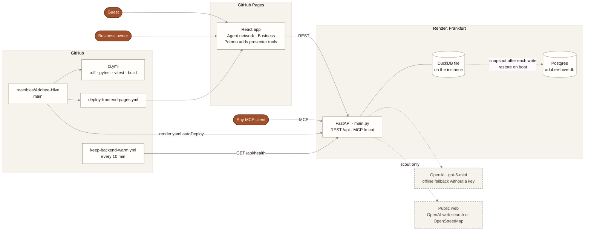
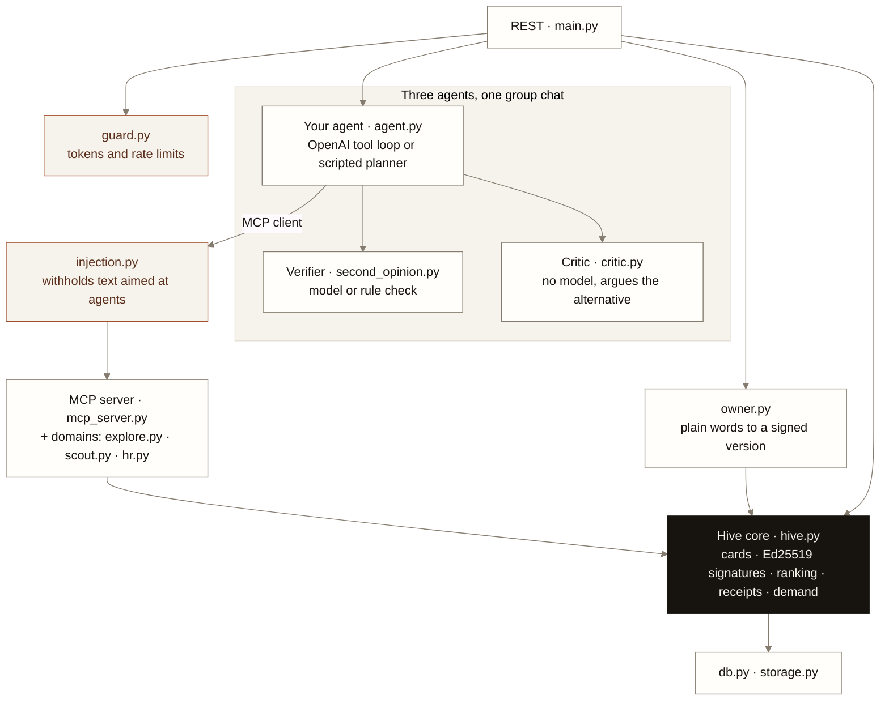
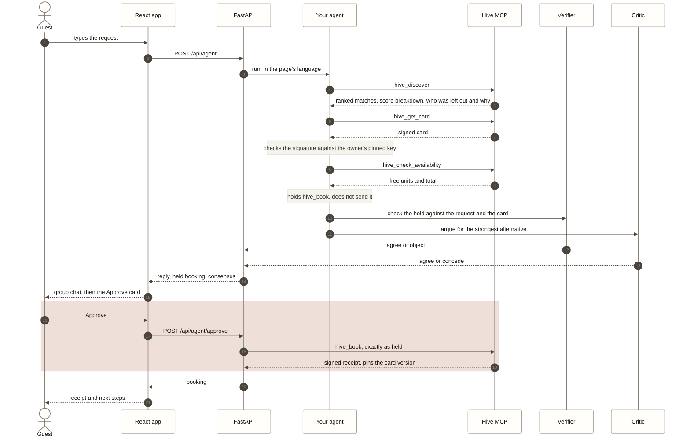
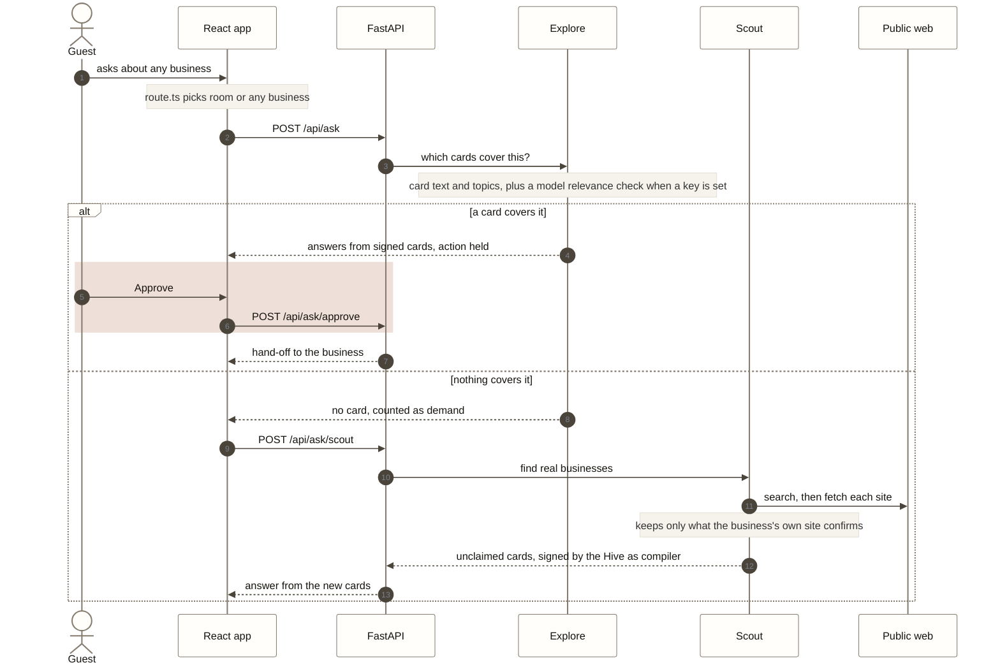

# Diagrams

Four pictures of what runs on `main`, for anyone joining the work: where each part is hosted, how a request
becomes a signed booking, how a question about any business finds an answer, and where the data lives. They are
Mermaid, so GitHub draws them and anyone can edit them as text. Change a picture in the same PR as the code it
shows; `tests/test_docs.py` fails when one names a file, MCP tool or endpoint that does not exist.

Clay marks the one step only a person can take: **Approve**. Every table of modules, tools and endpoints is in
[ARCHITECTURE.md](ARCHITECTURE.md); how to start and test each part is in the [developer guide](DEVELOPER.md).

## 1. The system

Two free hosts, one repo. A push to `main` redeploys both. The backend serves people over REST and agents over
MCP, from the same signed Hive cards.

Inside the backend, one Hive core sits under both doors. The REST endpoints call the agents; the agents reach the
Hive only as MCP clients, the same way an outside agent would.

## 2. A booking, from question to receipt

What happens when a guest types "a quiet room near SBB for two nights" in chapter 1. Nothing is booked until the
guest presses Approve; the agent holds the `hive_book` call on the server, and the button sends exactly that call,
once.

Without a key, or when OpenAI fails or times out, the scripted planner makes the same MCP calls and the verifier
uses its rule check, so the demo never stops. Card text reaches the agent as data, after `injection.py`.

## 3. A question about any business

When the question is not about a room, the app asks the Hive's other cards. If none covers it, the agents look on
the public web, verify what they find and add it as an unclaimed card, in the same conversation.

Unclaimed cards say so in every answer, owner edits refuse them, and approving only hands the person off to the
business's own site.

## 4. Where the data lives

One DuckDB file holds every card version, booking, review and demand count. The free Render disk is wiped on
every deploy, so with `DATABASE_URL` set the whole file is copied to Postgres after each write and copied back on
boot. Locally there is no Postgres; the file in `code/backend/data/` just stays.

Held bookings and held hand-offs stay in memory for 30 minutes; a restart only means asking the agent again. Every
card change goes through `hive.publish`, which signs the new version and keeps the old ones, so a receipt can always
show what was promised. `POST /api/demo/reset` goes back to the seed cards.

## Who works where

The pictures double as a map of the lanes in [CONTRIBUTING.md](../CONTRIBUTING.md). Pick a box, open its file,
find its test.

| Box | Code | Tests |
| --- | --- | --- |
| React app | `code/frontend/src` | `npm test`: `TravellerAgent.test.tsx`, `OwnerPanel.test.tsx`, `route.test.ts` |
| FastAPI, REST, docs | `main.py` | `test_docs.py`, `test_promises.py` |
| Hive MCP, booking | `mcp_server.py`, `hive.py` | `test_hive.py`, `test_promise.py`, `test_tool_errors.py` |
| Your agent, verifier, critic | `agent.py`, `second_opinion.py`, `critic.py` | `test_critic.py`, `test_injection.py`, `test_languages.py` |
| Any business, scout | `explore.py`, `scout.py` | `test_explore.py`, `test_relevance.py`, `test_scout.py` |
| Owner studio | `owner.py`, `waiting.py` | `test_owner_languages.py`, `test_waiting.py`, `test_card_stats.py` |
| Data | `db.py`, `storage.py`, `hive_seed.py` | `test_persist.py` |
| Hosting | `render.yaml`, `.github/workflows/` | CI on every PR |
