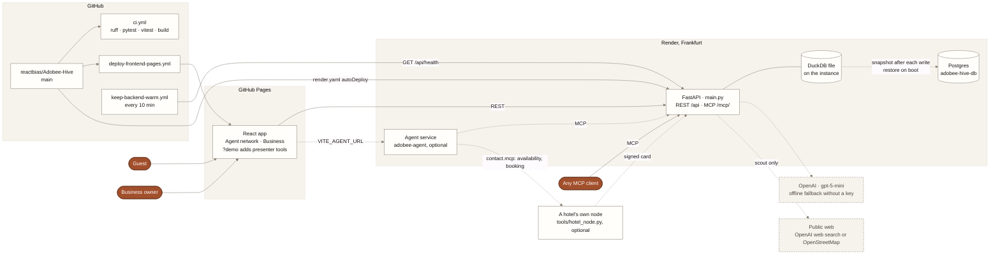
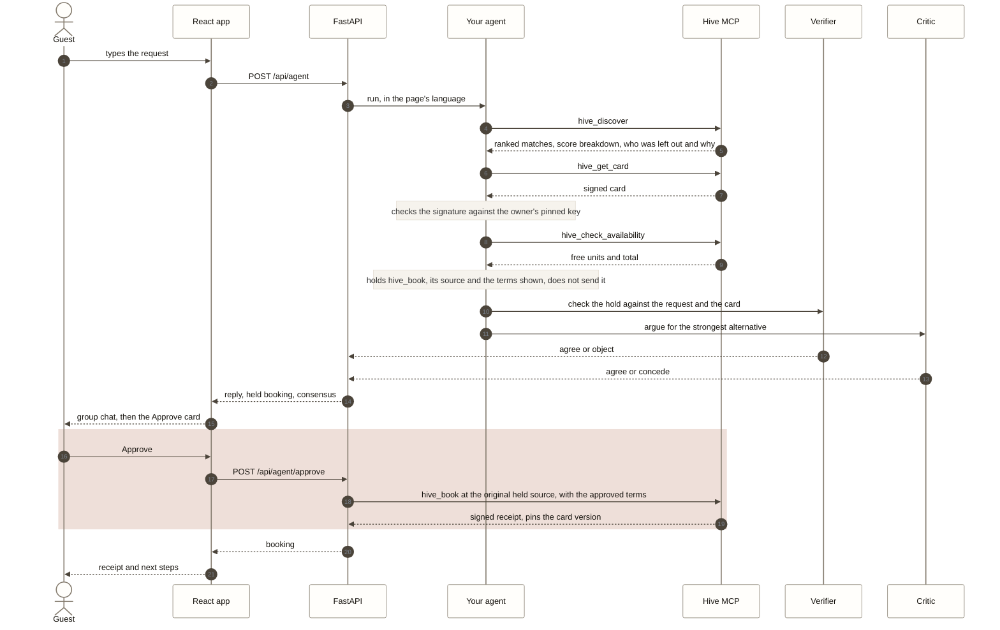
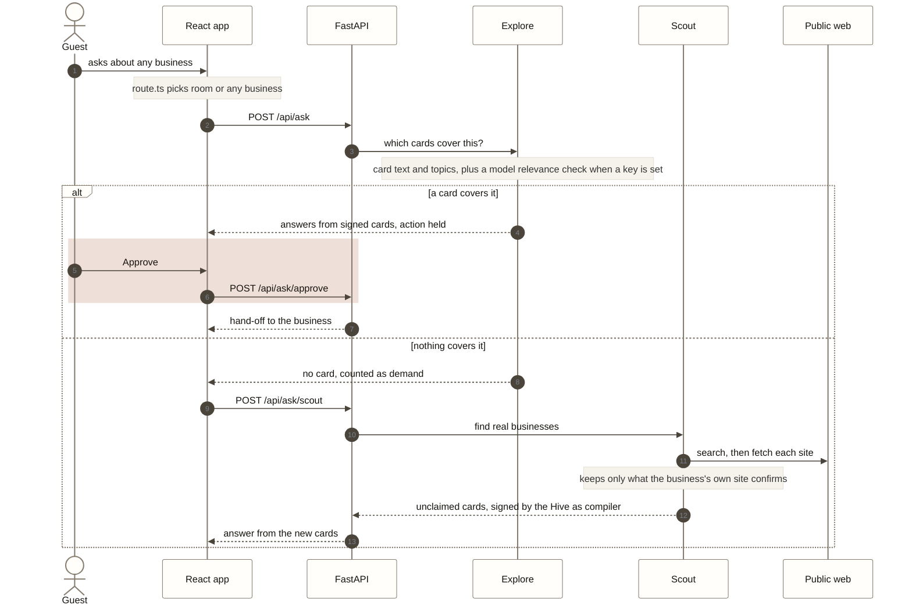
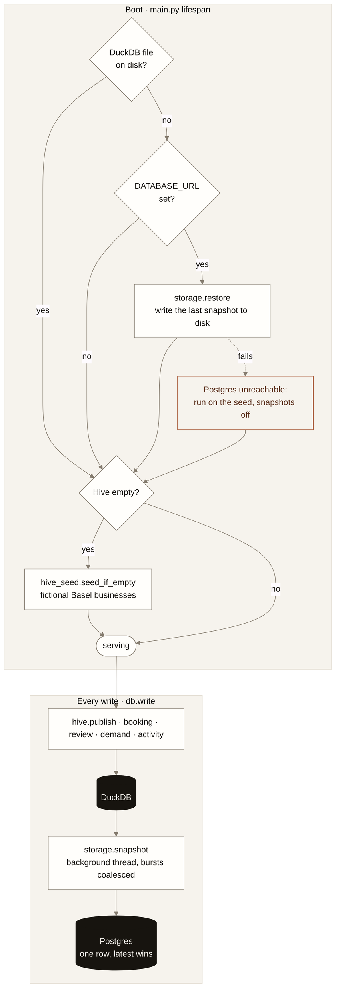
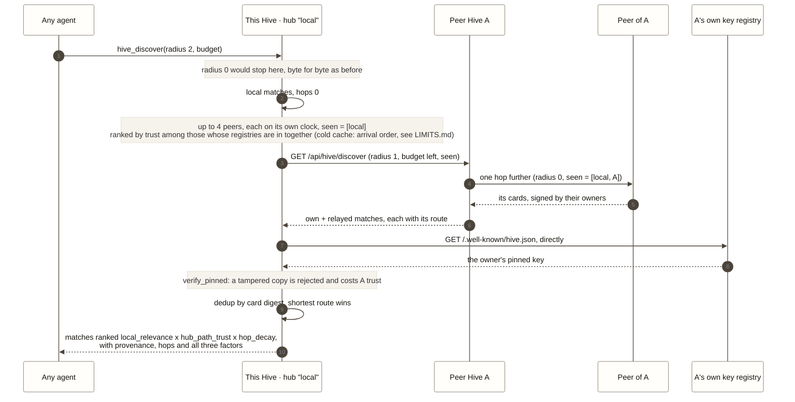

# Diagrams

Pictures of what runs on `main`, for anyone joining the work: where each part is hosted, how a request
becomes a signed booking, how a question about any business finds an answer, where the data lives, and every
door into the Hive. They are Mermaid, so GitHub draws them and anyone can edit them as text.

**Keep them true.** A PR that adds, removes or renames a backend module, MCP tool, endpoint, agent, hosting piece
or data path updates this page in the same PR, whoever writes it, person or agent. `tests/test_docs.py` enforces it
both ways: CI fails when a module under `code/backend/app`, an MCP tool or an endpoint is missing here, and when a
picture names a file, tool or endpoint that does not exist.

Clay marks the steps only a person can take, such as **Approve**. Every table of modules, tools and endpoints is in
[ARCHITECTURE.md](ARCHITECTURE.md); how to start and test each part is in the [developer guide](DEVELOPER.md).

## 1. The system

Two free hosts, one repo. A push to `main` redeploys both. The backend serves people over REST and agents over
MCP, from the same signed Hive cards.



Inside the backend, one Hive core sits under both doors. The REST endpoints call the agents; the agents reach the
Hive only as MCP clients, the same way an outside agent would.

The browser's `BackendStatus.tsx` checks the health door separately from model configuration, with a short
deadline, visible-tab refresh and retry. Explicit hotel prose at the REST discovery door reuses `agent.py`'s
stay parser; structured parameters override inferred constraints, and generic business searches stay generic.

```mermaid
%%{init: {"theme": "base", "themeVariables": {"primaryColor": "#fffefb", "primaryBorderColor": "#857c6f", "primaryTextColor": "#17140f", "lineColor": "#857c6f", "clusterBkg": "#f6f3ed", "clusterBorder": "#e4ded3", "noteBkgColor": "#f6f3ed", "noteBorderColor": "#e4ded3", "actorBkg": "#fffefb", "actorBorder": "#857c6f", "signalColor": "#4b443a", "signalTextColor": "#17140f", "fontFamily": "Helvetica, Arial, sans-serif"}}}%%
flowchart TB
  classDef core fill:#17140f,stroke:#17140f,color:#f6f3ed
  classDef mod fill:#fffefb,stroke:#857c6f,color:#17140f
  classDef guard fill:#f6f3ed,stroke:#a24f2c,color:#5a2e1a

  REST[REST · main.py]:::mod
  MCP[MCP server · mcp_server.py]:::mod

  subgraph DOMAINS["Use cases · domains/ · base.py"]
    EXP[explore.py<br/>any business, relevance]:::mod
    SCT[scout.py<br/>public web to unclaimed cards]:::mod
    HR[hr.py<br/>person cards]:::mod
    EXM[examples.py<br/>real businesses, unclaimed]:::mod
  end

  subgraph AGENTS["Three agents, one group chat"]
    A[Your agent · agent.py<br/>OpenAI tool loop or scripted planner]:::mod
    V[Verifier · second_opinion.py<br/>model or rule check]:::mod
    C[Critic · critic.py<br/>no model, argues the alternative]:::mod
  end

  INJ[injection.py<br/>withholds text aimed at agents]:::guard
  MIR[mirror.py<br/>demo only: a manipulated copy]:::guard
  GRD[guard.py<br/>tokens and rate limits]:::guard
  LLM[llm.py · config.py<br/>provider, model, timeouts]:::mod
  RPL[replies.py<br/>backend text in EN DE FR IT]:::mod
  OWN[owner.py<br/>plain words to a signed version]:::mod
  WAIT[waiting.py<br/>standing requests, signed offers]:::mod
  RUL[rulesets.py<br/>signed rules a person picks]:::mod
  SIM[simulate.py<br/>busy week for the demand map]:::mod
  ACT[activity.py<br/>live feed, one line per step]:::mod
  HIVE[Hive core · hive.py<br/>cards · Ed25519 signatures · ranking · receipts · demand]:::core
  FED[federation.py<br/>hop-limited search over peer Hives]:::mod
  REP[reputation.py<br/>peer hub trust · business trust]:::mod
  SEM[semantic.py<br/>offline similarity · stems · compounds · concepts<br/>optional embeddings]:::mod
  SHR[sharing.py<br/>per-item: public · confirm · push · never]:::mod
  BLK[blocklist.py<br/>manual admin blocks: hubs and entities]:::mod
  RMV[removals.py<br/>withdrawn entities: the hub stops carrying, history stays]:::mod
  AUD[audit.py<br/>the admin ledger: what changed, when, why]:::mod
  PRS[peers.py<br/>the peer list, stored: env is only the seed]:::mod
  SVC[services.py<br/>optional keys, write-only: in, never out]:::mod
  FLD[folders.py<br/>two agents link their folders: link · grant · read]:::mod
  FLK[folder_keys.py<br/>who is asking: a secret bound to one link, hashed at rest]:::guard
  CNX[connections.py<br/>introductions logged, scored by a human later]:::mod
  CAL[calibration.py<br/>did a hub's ratings match what our people found]:::mod
  HUB[hub.py<br/>search · connect · score, the agent's door]:::mod
  REG[registration.py<br/>one signed application, and who gets in]:::mod
  LIM[limits.py<br/>published ceilings, both doors, body size]:::guard
  ADM[admin.py<br/>settings, neighbours, blocklist, GUI-ready]:::mod
  SEED[hive_seed.py<br/>fictional Basel businesses]:::mod
  DB[db.py · storage.py]:::mod

  REST --> GRD
  REST --> A
  HIVE --> SEM
  HIVE --> SHR
  HIVE --> BLK
  FED --> BLK
  CNX --> CAL
  CAL --> REP
  REST --> HUB
  MCP --> HUB
  HUB --> CNX
  HUB --> FLD
  CNX --> FLD
  HUB --> SHR
  REST --> ADM
  ADM --> BLK
  ADM --> RMV
  REST --> RMV --> AUD
  HIVE --> RMV
  REST --> PRS --> AUD
  ADM --> PRS
  FED --> PRS
  REST --> SVC --> AUD
  LLM --> SVC
  REST --> LIM
  ADM --> SHR
  ADM --> CAL
  ADM --> FED
  ADM --> REG
  REST --> REG
  MCP --> REG
  REG --> LIM
  HIVE --> LIM
  REG --> HIVE
  REG --> BLK
  A -->|MCP client| INJ --> MCP
  MIR -.->|stress test| INJ
  A --> V
  A --> C
  A --> LLM
  V --> LLM
  A --> RPL
  REST --> OWN --> HIVE
  OWN --> WAIT
  REST --> SIM --> HIVE
  REST --> ACT --> DB
  MCP --> DOMAINS
  MCP --> RUL
  MCP --> WAIT
  MCP --> HIVE
  DOMAINS --> HIVE
  REST --> HIVE
  SEED --> HIVE
  HIVE -->|radius > 0| FED --> REP
  FED -->|peer Hives, HTTP| PEERS([Peer Hives<br/>stored list, HIVE_PEER_URLS seeds it]):::guard
  HIVE --> REP
  HIVE --> DB
```




## 2. A booking, from question to receipt

What happens when a guest types "a quiet room near SBB for two nights" in chapter 1. Nothing is booked until the
guest presses Approve; the agent holds the `hive_book` call, its selected MCP source and the terms the guest is
shown on the server. Approval reopens that source only, once; removing it from configuration refuses the action
instead of retargeting it. If the terms have changed by then, the source refuses, nothing is booked, and the guest
gets a new hold on the new terms.



Without a key, or when OpenAI fails or times out, the scripted planner makes the same MCP calls and the verifier
uses its rule check, so the demo never stops. Card text reaches the agent as data, after `injection.py`.

## 3. A question about any business

When the question is not about a room, the app asks the Hive's other cards. If none covers it, the agents look on
the public web, verify what they find and add it as an unclaimed card, in the same conversation.



Unclaimed cards say so in every answer, owner edits refuse them, and approving only hands the person off to the
business's own site. They are in `hive_discover` as well, where every result carries `claimed` and `bookable`, so
an agent can see that a card is a lead compiled from public information rather than a business that agreed.

## 4. Where the data lives

One DuckDB file per hub holds every card version, booking, review and demand count. A hotel's own node has its own file, with its card's key and its bookings. The free Render disk is wiped on
every deploy, so with `DATABASE_URL` set the whole file is copied to Postgres after each write and copied back on
boot. Locally there is no Postgres; the file in `code/backend/data/` just stays.



Held bookings and held hand-offs stay in memory for 30 minutes; a restart only means asking the agent again. Every
card change goes through `hive.publish`, which signs the new version and keeps the old ones, so a receipt can always
show what was promised. `POST /api/demo/reset` goes back to the seed cards.

## 5. Every door into the Hive

Every MCP tool and every REST endpoint, by who uses it. A new tool or endpoint goes here in the same PR, or CI
fails. What each one does: [ARCHITECTURE.md](ARCHITECTURE.md#mcp-tools-mcp-streamable-http).

```mermaid
%%{init: {"theme": "base", "themeVariables": {"primaryColor": "#fffefb", "primaryBorderColor": "#857c6f", "primaryTextColor": "#17140f", "lineColor": "#857c6f", "clusterBkg": "#f6f3ed", "clusterBorder": "#e4ded3", "noteBkgColor": "#f6f3ed", "noteBorderColor": "#e4ded3", "actorBkg": "#fffefb", "actorBorder": "#857c6f", "signalColor": "#4b443a", "signalTextColor": "#17140f", "fontFamily": "Helvetica, Arial, sans-serif"}}}%%
flowchart LR
  classDef door fill:#fffefb,stroke:#857c6f,color:#17140f
  classDef held fill:#a24f2c,stroke:#5a2e1a,color:#fffefb

  AGT([Any agent]) --> WK["GET /.well-known/hive.json"]:::door --> MCPT
  subgraph MCPT["MCP /mcp/"]
    direction TB
    M1[hive_discover · hive_rulesets · hive_get_card · hive_check_availability]:::door
    M2[hive_book · hive_what_was_promised · hive_cancel · hive_review]:::door
    M3[hive_wait · hive_check_waiting]:::door
    M4[explore_ask · hive_scout · hr_find_people · hr_request_intro · hr_decide_intro · hr_grant_cv · hr_read_cv · hr_create_job · hr_submit_cv]:::door
    M5[hub_connect · hub_score · hub_connections · hub_standing]:::door
    M6[hub_registration · hub_register · hub_directory]:::door
    M7[hive_owner_card]:::door
    M8[hive_owner_propose · hive_owner_publish]:::held
    M7 -. "X-Owner-Token on the connection" .-> M8
  end

  AGT --> HUBD
  subgraph HUBD["Reaching a person, and saying how it went"]
    direction TB
    H1["POST /api/hub/connect"]:::door
    H2["POST /api/hub/connections/{connection_id}/confirm · POST /api/hub/connections/{connection_id}/decline"]:::held
    H3["POST /api/hub/connections/{connection_id}/score"]:::held
    H3b["GET /api/hub/connections/{connection_id}/decision"]:::door
    H4["GET /api/hub/connections · GET /api/hub/standing"]:::door
  end


  subgraph FLDD["A linked folder, read over HTTP"]
    direction TB
    F1["GET /api/folders/status"]:::door
    F2["GET /api/folders/manifest"]:::held
    F3["GET /api/folders/file"]:::held
    F4["POST /api/folders/keys"]:::held
    F5["GET /api/folders/grants · POST /api/folders/grants"]:::held
    F6["DELETE /api/folders/grants/{grant_id} · DELETE /api/folders/links/{link_id}"]:::held
    F2 -. "Bearer link secret" .-> F3
    F4 -. "Bearer link secret" .-> F5
  end

  AGT --> FLDD

  JOIN([Someone who wants to join]) --> REGD
  subgraph REGD["Joining a hub"]
    direction TB
    J1["GET /api/hub/directory · GET /api/hub/registration"]:::door
    J2["POST /api/hub/register"]:::door
    J3["GET /api/hub/register/{application_id} · GET /api/hub/register/{application_id}/withdrawal"]:::door
    J4["POST /api/hub/register/{application_id}/withdraw"]:::held
  end

  ADMN([Hub operator]) --> ADMD
  subgraph ADMD["Administration · the admin panel, or curl"]
    direction TB
    D0["POST /api/admin/login · POST /api/admin/logout"]:::held
    D0b["POST /api/admin/applications/{application_id}/withdraw"]:::held
    D0c["POST /api/admin/connections/{connection_id}/{action}"]:::held
    D1["GET /api/admin/overview · /api/admin/settings · /api/admin/neighbours"]:::door
    D2["GET /api/admin/blocklist"]:::door
    D3["POST /api/admin/blocklist · DELETE /api/admin/blocklist/{kind}/{subject}"]:::held
    D0 -. "X-Admin-Token" .-> D3
    D6["GET /api/admin/entities · GET /api/admin/entities/{entity_id} · GET /api/admin/audit"]:::door
    D7["POST /api/admin/entities/{entity_id}/remove · POST /api/admin/entities/{entity_id}/restore"]:::held
    D8["GET /api/admin/peers · GET /api/admin/services"]:::door
    D10["POST /api/admin/services/{name} · DELETE /api/admin/services/{name} · POST /api/admin/services/{name}/check"]:::held
    D0 -. "X-Admin-Token" .-> D10
    D9["POST /api/admin/peers · PUT /api/admin/peers · POST /api/admin/peers/remove · POST /api/admin/peers/check"]:::held
    D0 -. "X-Admin-Token" .-> D9
    D0 -. "X-Admin-Token" .-> D7
    D4["GET /api/admin/applications"]:::door
    D5["POST /api/admin/applications/{application_id}"]:::held
  end

  APP([React app]) --> AGR & ASK & CRD & OWN & OPS
  subgraph AGR["Chapter 1 · a room"]
    direction TB
    R1["POST /api/agent"]:::door
    R2["POST /api/agent/approve"]:::held
  end
  subgraph ASK["Chapter 1 · any business"]
    direction TB
    R3["POST /api/ask"]:::door
    R4["POST /api/ask/scout"]:::door
    R5["POST /api/ask/approve"]:::held
  end
  subgraph CRD["Cards and trust"]
    direction TB
    R6["GET /api/hive/cards"]:::door
    R21["GET /api/hive/discover"]:::door
    R7["GET /api/hive/cards/{card_id}"]:::door
    R8["GET /api/hive/cards/{card_id}/availability"]:::door
    R9["POST /api/hive/cards/{card_id}/book"]:::door
    R9B["POST /api/hive/cards/signed"]:::held
    R10["POST /api/hive/reviews"]:::door
    R11["POST /api/hive/verify"]:::door
  end
  subgraph OWN["Chapter 2 · business"]
    direction TB
    R12["GET /api/owner/{card_id}"]:::door
    R13["POST /api/owner/{card_id}/propose"]:::door
    R14["POST /api/owner/{card_id}/publish"]:::held
    R15["GET /api/hive/demand"]:::door
  end
  subgraph OPS["Health and ?demo"]
    direction TB
    R16["GET /api/health"]:::door
    R20["GET /api/activity"]:::door
    R17["POST /api/hive/demo/forge/{card_id}"]:::door
    R18["POST /api/demo/simulate"]:::door
    R19["POST /api/demo/reset"]:::door
  end
```



Clay marks the calls that act on a person's yes: Approve, or the owner's Publish. The owner's three MCP
tools are the same three doors for an agent working on its person's behalf: `hive_owner_card` reads (and
needs nothing), `hive_owner_propose` and `hive_owner_publish` need the owner token in the `X-Owner-Token`
header of the MCP connection and refuse without it, on a hub that has set one and on a hub that has not.

## 6. How far to look: a federated search

`hive_discover` takes a **radius**: `0`, the default, is this Hive only, and nothing about today's answer
changes. Above it the query hops to peer Hives, each hop decrementing the radius, naming itself in `seen` so the
cycles in the peer graph cannot loop, and spending what is left of the time budget. A card that comes back is
verified here, against the key pinned in *its own* hub's registry — never against the carrier's word — so a
relaying hub can withhold or delay a card but never forge one. Details: [federation.py](../code/backend/app/federation.py)
and [reputation.py](../code/backend/app/reputation.py).

Registry outcomes are memoized per search, including empty/unavailable startup answers. The same origin is
not fetched again per returned card, while a later search can retry and recover without a restart.


Four modules carry the hub's own side of that. [sharing.py](../code/backend/app/sharing.py) decides per item what may
leave at all — `public`, `confirm`, `push` (held, but never searchable) or `never` — and the stricter of the item's flag
and the entity's default always wins. [blocklist.py](../code/backend/app/blocklist.py) is the manual override an
operator reaches for, blocking a peer hub or a single entity in both directions, with a reason that has to be readable
six months later. [peers.py](../code/backend/app/peers.py) holds the list of neighbours itself, so an operator adds or drops one while the hub runs and the next search obeys; `HIVE_PEER_URLS` is only what a fresh hub starts from. [removals.py](../code/backend/app/removals.py) is the other override, and it is deliberately not the same one: it takes an entity off *this* hub — out of discovery, not bookable — while keeping every signed version, so a receipt can still prove what the card promised. [connections.py](../code/backend/app/connections.py) logs every introduction and waits, sometimes for
weeks, for a person to score how the real meeting went; an introduction nobody scores goes stale rather than staying
open for ever. [calibration.py](../code/backend/app/calibration.py) turns those scores into the only number that
matters about a peer: `published - realised`, in tenths of a star, lower is better. A hub is judged on whether it told
the truth about its members, never on how good they were.



A peer that misses the deadline is dropped and named in `federation.dropped`; the query still answers with
everything else. A hub that declares paid placement, or that relays cards which fail verification here, loses
trust, and with it the rank of every card it carries — so vetting its own members honestly is the hub's own
interest.

### Asking the peers who they are

Choosing a hub is a different question from searching one, and it is asked before anybody has searched anything.
So a hub does not wait for a federated query to learn its peers' names: `federation.keep_peers_fresh` asks each
peer's discovery document on a timer for as long as the hub runs, and keeps the answers in a peer book. A peer is
named, described and counted in *its own* words; what this hub contributes is the calibration column, which is
the one thing a peer cannot say about itself.

Reading the directory never asks anybody. That is the whole point: the picker may poll, and one peer that has
stopped answering must not make choosing a hub slow, or the picker feels broken again.

```mermaid
%%{init: {"theme": "base", "themeVariables": {"primaryColor": "#fffefb", "primaryBorderColor": "#857c6f", "primaryTextColor": "#17140f", "lineColor": "#857c6f", "clusterBkg": "#f6f3ed", "clusterBorder": "#e4ded3", "noteBkgColor": "#f6f3ed", "noteBorderColor": "#e4ded3", "actorBkg": "#fffefb", "actorBorder": "#857c6f", "signalColor": "#4b443a", "signalTextColor": "#17140f", "fontFamily": "Helvetica, Arial, sans-serif"}}}%%
sequenceDiagram
  autonumber
  participant P as A person choosing a hub
  participant APP as InstanceFinder
  participant H0 as This hub
  participant BOOK as federation peer book
  participant P1 as Peer "zurich"
  participant P2 as Peer that has stopped answering

  Note over H0,BOOK: every PEER_ASK_SECONDS, off any request path
  H0->>P1: GET /.well-known/hive.json (PEER_ASK_TIMEOUT_S)
  P1-->>H0: hub_id, name, description, admission, entities
  H0->>P2: the same ask, at the same moment
  P2--xH0: no answer within the timeout
  H0->>BOOK: zurich: answered, stamped now<br/>the other: asked now, did not answer, keep the last good answer
  P->>APP: open the finder
  APP->>H0: GET /api/hub/directory
  H0->>BOOK: read only, never ask
  BOOK-->>H0: real names, real counts, when each was last asked
  H0-->>APP: hubs[], each with last_asked and last_asked_ok
  Note over APP: a hub never asked says so; nothing is shown as zero
```

A peer that has genuinely never been asked carries `last_asked: null`, and the row says so rather than
pretending. One that answered and has since gone quiet keeps the name and count it gave, marked stale, because an
answer from two minutes ago is more use than no answer at all — as long as the row admits how old it is.

## 7. Two folders link, and only then is anything booked

The index is public and says the *shape* of a business: paths, sizes, digests, never a byte of the contents. So
between "found you" and "booked you" there is a step of its own, and it is the one the whole product rests on.
[folders.py](../code/backend/app/folders.py) owns it, in two layers that are deliberately not one layer:

- **The link** is handle to handle, and carries no content at all. What it unlocks is the *manifest*: a linked
  peer gets to see that the `shared` files exist, which the Card never said. `private` and `hidden` paths are
  counted and never named — listing a file in order to say it is secret leaks its existence, so a refused grant
  says the same words for a hidden file as for a file that was never there.
- **A grant** is per path, and is the only thing that makes bytes readable. It is the owner's to give. `public`
  is the one case needing no grant: it is already published, and a grant for it would be theatre.

That is the shape [ClaudeConnect](https://github.com/bstadt/cc_daemon) already has — `add_friend` and
`accept_friend_request` for the link, `add_recipient_to_file` for the grant, both over plain identity strings —
which is why `LocalFolderLink` (in this process, over the folders in `testdata/vaults/`) and `CcFolderLink` (the
real library) sit behind one protocol, chosen by `FOLDER_LINK`. The local one is the default and needs no key, no
network and no new dependency; `/api/health` says which one is in use and, if the real one was asked for and
could not be had, why the hub is running on the other.

A connection is refused outright when there is no link, because a booking made without one is a booking made on
what the index said rather than on what the two agents actually agreed.

```mermaid
%%{init: {"theme": "base", "themeVariables": {"primaryColor": "#fffefb", "primaryBorderColor": "#857c6f", "primaryTextColor": "#17140f", "lineColor": "#857c6f", "clusterBkg": "#f6f3ed", "clusterBorder": "#e4ded3", "noteBkgColor": "#f6f3ed", "noteBorderColor": "#e4ded3", "actorBkg": "#fffefb", "actorBorder": "#857c6f", "signalColor": "#4b443a", "signalTextColor": "#17140f", "fontFamily": "Helvetica, Arial, sans-serif"}}}%%
sequenceDiagram
  autonumber
  participant AG as Traveller's agent
  participant HUB as hub.py
  participant FLD as folders.py
  participant CNX as connections.py
  participant OWN as The owner

  AG->>HUB: hub_connect(requester, entity_id)
  HUB->>FLD: request_link(requester, entity)
  Note over FLD: a published, freely connectable Card<br/>is a standing yes; a `confirm` Card is not
  FLD-->>HUB: link established, or requested
  HUB->>CNX: request(..., folder_link=link)
  CNX->>FLD: is this pair actually linked?
  CNX-->>HUB: open (link established) · requested (link waiting)
  OWN->>CNX: confirm
  CNX->>FLD: accept_link — the owner's yes is the owner's yes
  CNX-->>OWN: open, and the link now holds
  AG->>FLD: manifest(entity, requester)
  FLD-->>AG: public · public-summary · shared, and a count of what was withheld
  OWN->>FLD: grant("entity/rates/2027-spring.md", requester)
  AG->>FLD: read that one path
  Note over AG,FLD: no link, or no grant → refused, in the same words either way
```

A connection row made before any of this existed carries no link, and nothing in the hub asks it for one: an old
row can still be confirmed, scored and counted. The precondition is on making a new booking, not on reading the
log of the bookings already made.

## Who works where

The pictures double as a map of the lanes in [CONTRIBUTING.md](../CONTRIBUTING.md). Pick a box, open its file,
find its test.

| Box | Code | Tests |
| --- | --- | --- |
| React app | `code/frontend/src` | `npm test`: `TravellerAgent.test.tsx`, `OwnerPanel.test.tsx`, `route.test.ts` |
| FastAPI, REST, docs | `main.py` | `test_docs.py`, `test_promises.py` |
| Hive MCP, booking | `mcp_server.py`, `hive.py` | `test_hive.py`, `test_promise.py`, `test_tool_errors.py` |
| Your agent, verifier, critic | `agent.py`, `second_opinion.py`, `critic.py` | `test_critic.py`, `test_injection.py`, `test_languages.py` |
| Any business, scout | `explore.py`, `scout.py` | `test_explore.py`, `test_relevance.py`, `test_scout.py` |
| Owner studio | `owner.py`, `waiting.py` | `test_owner_languages.py`, `test_waiting.py`, `test_card_stats.py` |
| Live activity feed | `activity.py`, `ActivityPanel.tsx` | `test_activity.py`, `ActivityPanel.test.tsx` |
| Pick a Hive, run a hub | `guard.py`, `admin.py`, `InstanceFinder.tsx`, `AdminPanel.tsx` | `test_admin_login.py`, `InstanceFinder.test.tsx`, `AdminPanel.test.tsx`, `calibration.test.ts` |
| Where a result came from | `federation.py`, `TraceParts.tsx`, `provenance.ts` | `test_federation.py`, `TraceParts.test.tsx`, `provenance.test.ts` |
| The network, live | `admin.py`, `calibration.py`, `NetworkPanel.tsx`, `network.ts` | `test_hub_api.py`, `NetworkPanel.test.tsx`, `network.test.ts` |
| Folders linked, then booked | `folders.py`, `connections.py` | `test_folders.py`, `test_hub_trust.py` |
| A linked folder read over HTTP | `folder_keys.py`, `main.py` | `test_folder_api.py` |
| Data | `db.py`, `storage.py`, `hive_seed.py` | `test_persist.py` |
| Hosting | `render.yaml`, `.github/workflows/` | CI on every PR |
