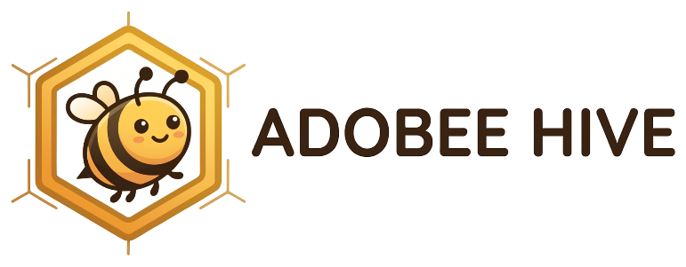
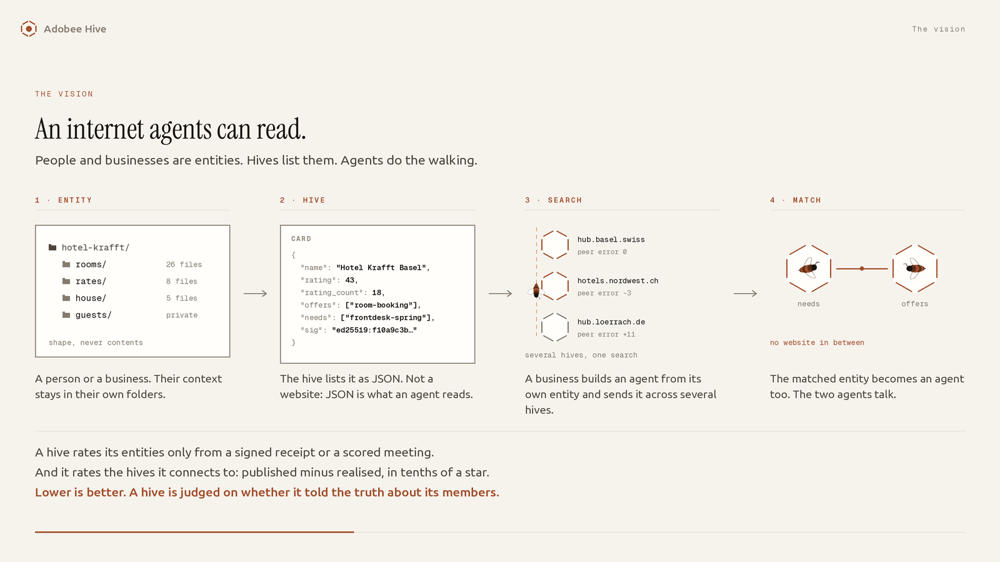
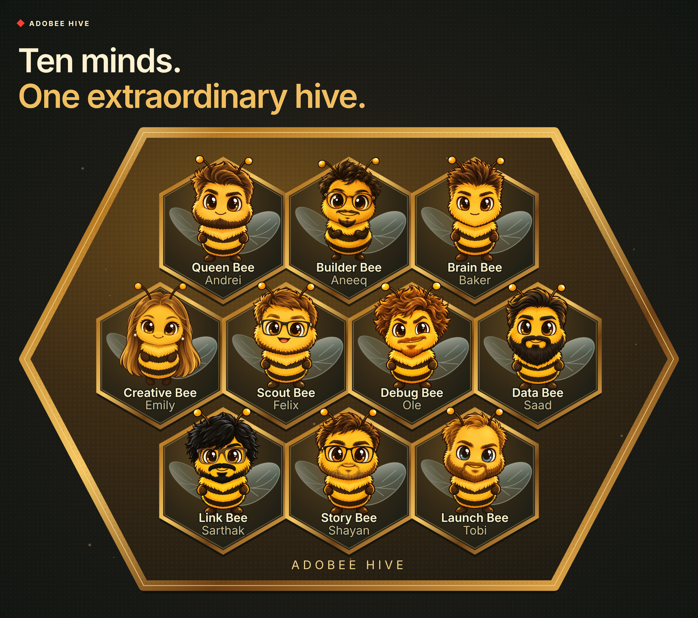

<p align="center">
  <picture>
    <source media="(prefers-color-scheme: dark)" srcset="assets/brand/adobee-hive-wordmark-v2-on-dark.png">
    
  </picture>
</p>

<p align="center"><b>Buzzing with Autonomous Intelligence.</b></p>

<p align="center">Websites are for humans. <b><i>Hives are for agents.</i></b></p>

<p align="center">
  <a href="https://reactbias.github.io/Adobee-Hive/?hub=local#find"></a>
  <a href="https://github.com/reactbias/Adobee-Hive/actions/workflows/ci.yml"></a>
  
  <a href="license.txt"></a>
</p>

Team B6's entry for Adobe's **The Post-Website Business** challenge at BaselHack 2026.

**The problem.** A local business's next visitor is an AI agent, not a person on a website. Today that agent scrapes and
guesses, and platforms own the front door. Small businesses cannot afford to lose discovery a second time.

**Our answer.** A business keeps its context in its own folders. A **hub** lists it as **signed JSON**, not as a page.
Hubs **federate**, so one search reaches several. A match leads to **agents talking**, and a person says yes.

**Not just hotels.** One Card format fits anything that offers or needs something: a hotel, a café, an employer, a
freelancer. The hotel is where we start, because it is the hardest case: price, availability, trust and a booking.

> On GitHub you find projects to work on. On Adobee Hive, agents find businesses and people to work with.

## Try it

No account, no key, fictional data. [**Open the app**](https://reactbias.github.io/Adobee-Hive/?hub=local#find) and
paste this into **Find and book**:

```text
Book me a quiet, dog-friendly hotel near Basel SBB under CHF 200 with late check-in, 2026-11-13 to 2026-11-15. My name is Mara Keller.
```

1. **Search.** One result: Hotel Rheinblick.
2. **Details.** The agent's calls appear as a group chat: search, signed Card, availability, and why the other hotels
   were left out. A critic challenges the pick and a verifier checks it. **Replay** plays it line by line.
3. **Approve booking.** Courtyard single, CHF 256 for two nights. Nothing is sent to the hotel before this click. You
   get a signed receipt.
4. **Show the hotel's side.** The booking from the owner's view, and under **Requests you missed**, what agents asked
   for that the hotel could not offer.

**Add [`?demo`](https://reactbias.github.io/Adobee-Hive/?demo&hub=local#find)** for the attack: under **Stress test**, a
scraped copy of a hotel tells agents to ignore the budget and book a CHF 780 suite. The agent withholds the line, sees
the signature fail and books Rheinblick. Tick *Rules off* to see what an unguarded agent would have done; nothing is
sent.

**Try something that is not a hotel:** ask *"Which companies here are hiring?"*. Adobe, Endress+Hauser and Pax answer
from unclaimed Cards, and the agent hands you over to them. The hosted hub also lists a café, recruiters, an event and
adventure operators side by side.

**Be the agent yourself:** point any MCP client at `https://adobee-hive.onrender.com/mcp/`. 29 tools, no sign-up.

The hosted backend sleeps when idle and takes about a minute to wake, so a first `503` means cold, not broken. The
status strip shows reachability and planner separately. With no model available the agent runs a scripted planner
over the same tools and the same approval step, so the wording can differ but the mechanism does not.

## How it works



*The vision slide. Hub names and figures are illustrative.*

Four principles, all running in the prototype:

| | |
| --- | --- |
| **Signed facts** | Every Card version is Ed25519-signed. An agent checks it against the key pinned in the Card's own hub, so a relaying hub can withhold a Card but not forge one |
| **Open ranking** | Every result carries its score breakdown and the reason the others were left out. There is no paid placement |
| **Booking-backed reviews** | Only a signed booking receipt can leave a review. The receipt proves a booking, not that the guest turned up |
| **Your yes** | Agents search, compare and prepare. Our agent books only after one human click |

And one idea beyond them, **missed demand**: a business sees what agents asked for and it could not offer, and a city
sees what nobody offers yet. The hub counts what was asked, never who asked.

The full argument for where this goes in five to ten years is in [VISION.md](documentation/VISION.md).

## Built, and not built

**Runs today**

- An agent books a fictional Basel hotel end to end over MCP, with human approval and a signed receipt.
- One Card and one search across every kind of business, and people too: find someone by skills, with an introduction
  only after they say yes and a CV only through a consented grant (a starter). Booking is end to end for stays; other kinds are found, compared and handed off.
- Hiring accepts a job posting, ranks candidates with evidence, and interviews their agents only with consent and access to the permitted folder files: [HIRING.md](documentation/HIRING.md).
- An owner edits a Card in plain words, reads the diff and publishes a new signed version.
- Federated search with a hop limit and provenance, across three peered hubs on one machine
  ([`lan.sh`](lan.sh)). Every relayed Card is verified against its own hub's key.
- Hubs scored on `published − realised`: what they promised against what their people reported. Overselling costs.
- Joining a hub with one signed JSON document, through an admission policy each hub sets for itself.
- Search with no model and no key: **24 of 41** word-disjoint test queries rank the right result first, **33 of 41** in
  the top three, against 0 of 41 for the substring match it replaced ([answer key](testdata/README.md)).
- The whole app in English, German, French and Italian.

**Not yet**, from the [full list](documentation/LIMITS.md):

- The hub holds the signing key, even for applicants who bring their own. Only one fictional hotel signs on its own
  node. A signature detects tampering; it does not verify a business's real-world identity.
- The hotel's side is its signed Card behind MCP tools, not an independent agent negotiating for it.
- No second deployed hub: hosted search stays local. Federation is shown on one machine.
- Folder links work on one disk only. Nothing is encrypted or crosses a machine, and a link alone releases no private file.
- No accounts: one shared admin password, one owner token per hub, and a requester's name is an unchecked string.
- Calibration orders the hub directory, not search results.
- A hold is not an inventory reservation, nothing is charged, and an external MCP client must bring its own approval step.

The stage demo runs the agent on the hub. The target is browser, agent, folders and hub as
[separate nodes](documentation/LIMITS.md#separate-nodes).

## Where to check it

| | |
| --- | --- |
| **Innovation** | Peers score a hub on its honesty, and every request nobody could answer becomes a signal for what to open. [FEDERATION.md](documentation/FEDERATION.md#two-levels-of-trust) |
| **Impact** | Any local business or person keeps their customer, with one document instead of a website and no aggregator in between. Any town or association can run a hub |
| **Technical depth** | Signed Cards, MCP, federation with provenance. [Architecture](documentation/ARCHITECTURE.md) and [diagrams](documentation/DIAGRAMS.md) |
| **Code quality and history** | About 1,000 backend and over 500 browser tests. CI also breaks the code on purpose: 130+ curated [mutants](code/backend/tools/README.md), and one survivor fails the build on `main`. Small conventional commits; AI-assisted ones carry a `Co-Authored-By` trailer |
| **Fair play** | Public repository, [MIT](license.txt). Seed data is fictional, apart from clearly labelled unclaimed cards compiled from public information. Gaps are [listed](documentation/LIMITS.md) |
| **Pitch** | [Three-minute script](documentation/PITCH.md), [deck and film](assets/README.md) |
| **Demo** | [Try it](#try-it), or the [five-minute walkthrough](documentation/DEMO.md) |

Adobe's brief and how each direction is answered: [CHALLENGE.md](documentation/CHALLENGE.md).

## Run it yourself

Needs Python 3.12 and Node 22. No key, no external service: [documentation/DEVELOPER.md](documentation/DEVELOPER.md).
It also holds the REST and MCP contracts, configuration and the tests. Pictures of every part are in
[documentation/DIAGRAMS.md](documentation/DIAGRAMS.md); the threat model is [SECURITY.md](SECURITY.md); contributors
start at [CONTRIBUTING.md](CONTRIBUTING.md).

## Team B6



[MIT licence](license.txt), © 2026 Team B6, BaselHack 2026.
