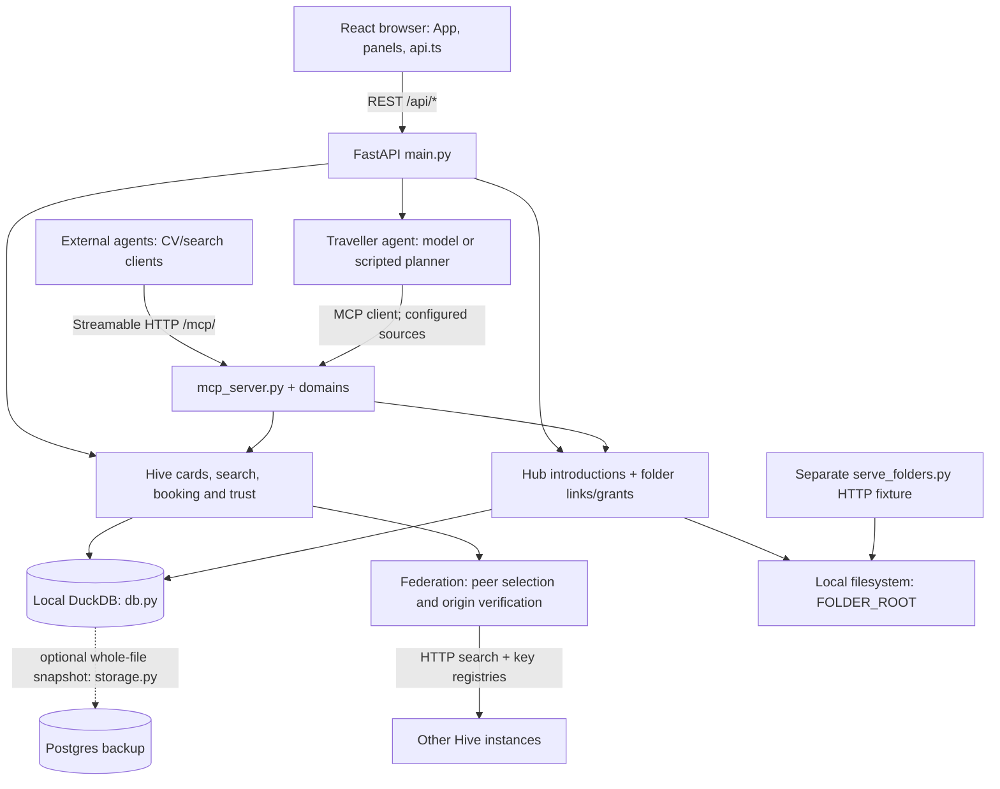

<p align="center"></p>

# Adobee Hive — team working guide

BaselHack 2026, Team B6, Adobe's **The Post-Website Business** challenge. We are building a directory of signed business/person cards that people use through a web app and agents use through MCP. Hotels are the first booking workflow; finding people and their supporting files is the next integration.

**This README is the handover for our three-hour focus block, not the jury pitch.** Architecture checked against `main` at [`067d7d8`](https://github.com/reactbias/Adobee-Hive/tree/067d7d8354745876e094d01fb2a64bc653ea9e23). Pending work below is not a shipped capability. The pre-presentation rewrite is tracked in [#147](https://github.com/reactbias/Adobee-Hive/issues/147).

Start with [your lane](#team-focus-block), [local setup](#run-it-locally-in-5-minutes), then the [REST/MCP contracts](#integration-contracts). Use fictional data throughout.

## Links

| Need | Entry point |
| --- | --- |
| Local app / REST docs / MCP | http://localhost:5173 · http://localhost:8000/docs · http://localhost:8000/mcp/ |
| Public app | https://reactbias.github.io/Adobee-Hive/ — deployment can lag `main` |
| Public backend | [Health](https://adobee-hive.onrender.com/api/health) · [REST docs](https://adobee-hive.onrender.com/docs) · [MCP](https://adobee-hive.onrender.com/mcp/) |
| Work queue / integration | [Issues](https://github.com/reactbias/Adobee-Hive/issues) · [PRs](https://github.com/reactbias/Adobee-Hive/pulls) · [CI/deploys](https://github.com/reactbias/Adobee-Hive/actions) |
| Detailed maps | [Architecture/module inventory](documentation/ARCHITECTURE.md) · [Diagrams](documentation/DIAGRAMS.md) · [Developer guide](documentation/DEVELOPER.md) |
| Working agreements | [Contributing/file ownership](CONTRIBUTING.md) · [Team](documentation/TEAM.md) · [Security](SECURITY.md) · [Known limits](documentation/LIMITS.md) |
| Deck and rehearsal | [Pitch](documentation/PITCH.md) · [Demo](documentation/DEMO.md) · [Vision](documentation/VISION.md) · [Assets](assets/README.md) |

## Team focus block

These are the current named assignments; they supersede older workstream/next-deliverable lists. Agree the issue and shared-file changes with Ole before starting. **Andrey's two lanes are alternatives, not two simultaneous commitments.**

| Who | Focus | Starting point and handover |
| --- | --- | --- |
| **Tobi (`reactbias`)** | UI and the end-to-end browser experience | `code/frontend/src/App.tsx`, `pages/TravellerAgent.tsx`, `panels/`, `components/`, `api.ts`, `i18n/`. Keep selected-hub status, discovery, Details, explicit approval and receipt usable. Coordinate API changes with Ole; pair with Andrey on the hotel-MCP alternative below. |
| **Andrey (`dodonov-dev`)** | Support fuzzy search over the cards' JSON; **alternatively**, help Tobi handle a hotel that advertises its own booking MCP in a discovered folder | Search: `app/hive.py`, `app/semantic.py`, [Search API](documentation/SEARCH_API.md), `tools/eval_answer_key.py`, `tools/eval_search.py`. Work with the existing offline matcher and score breakdown. Hotel-MCP option: [provider handoff](#a-hotel-advertises-its-own-booking-mcp), with Tobi and Ole; agree a real provider contract before changing routing. |
| **Saad + Emily (`asukuna`)** | A coherent slide deck, with a complete understanding of the actual architecture | Follow the [architecture](#architecture-on-main) and [journeys](#the-two-journeys), then `documentation/PITCH.md`, `DEMO.md`, `VISION.md`, `assets/`. Show the implemented system separately from future vision; check each technical claim with its lane owner. |
| **Felix + baker** | Tests, measured performance gains, stability and fixes for existing issues — **nonbreaking changes only** | `code/backend/tests/`, frontend `*.test.ts(x)`, `code/backend/tools/`. Pick a bounded issue with Ole, reproduce on current `main`, add a behavior regression, measure before/after for performance work. Keep public schemas, signatures, consent/approval gates and offline behavior intact; no broad refactor or dependency/DB cutover. See [stability work](#stability-work-without-breaking-the-demo). |
| **Aneeq + Sarder + Shayan** | A separate system that finds CVs in folders; learn the hub MCP and integrate discovery/access | Start with [MCP](#mcp-for-an-external-agent) and [the CV/folder path](#cv-and-folder-integration). Distinguish card metadata from file bytes. Use the fictional HTTP fixture now; coordinate the authenticated hub read surface with Ole rather than inventing folder MCP tools. Bring back one candidate → permitted CV → extraction result with source attribution and a clear blocked/denied outcome. |
| **Ole (`busssard`)** | Keep the team focused and supply a working backend MCP/REST API | `code/backend/app/main.py`, `mcp_server.py`, `domains/`, `config.py`, `guard.py`, storage and folder integration. Own shared-contract decisions, backend availability, integration order and rehearsal. Unblock other lanes without changing their interfaces underneath them. |

`app/...` above means `code/backend/app/...`. Coordinate edits to `main.py`, `mcp_server.py`, `api.ts`, `hive.py`, `config.py`, auth and deployment files; those are shared boundaries, not independent sandboxes.

**How to use the block:** get a clean run and agree one deliverable per lane first; spend the middle on small tested changes; reserve the end for integration and rehearsal, not new architecture. Hand over the branch/PR, exact entry command, changed contract, observed result and remaining blocker. Do not merge another lane's unfinished work merely to make a demo appear complete.

## Architecture on main

This is a **single-instance Python backend**, not a microservice system. React/Vite/TypeScript is the browser client; FastAPI serves REST and mounts the MCP Streamable HTTP server. Both reach the same core modules and local DuckDB. Domain modules add HR, Explore and Scout tools, rather than separate databases.



### Boundaries to keep straight

- **Index versus files.** A Card is JSON with offers/needs, descriptions and optional folder metadata. Original PDFs, images and other bytes stay on disk; DuckDB/Postgres do not constitute a file-sync service. The fixture server is a separate development process, not a route on the hub.
- **Search versus models.** `hive.discover()` combines explicit constraints, literal matching and the implemented offline similarity provider. It does not need an LLM key or an external vector database. Optional embeddings are not implemented.
- **Peers versus booking providers.** `HIVE_PEER_URLS` seeds the hub's peer table for HTTP federation; the operator can then change that table at runtime. `HIVE_MCP_URLS` configures the traveller agent's MCP sources. Empty means the local in-process Hive; a nonempty list replaces that default. Neither setting discovers a hotel provider from folder text.
- **Signatures versus identity.** `hive.publish()` signs normalized, versioned card JSON with a hub-held per-card Ed25519 key, retains history and publishes the verification key in the origin registry. This detects tampering; it is not verified real-world business identity or implemented owner-held signing custody.
- **Reputation versus calibration.** Federation uses source relevance × carrier-path trust × hop decay. Published-versus-realised introduction ratings produce calibration/standing, but outcome calibration is not yet a federated ranking factor.
- **Persistence versus production durability.** DuckDB is the working database. Optional `DATABASE_URL` restores a missing local file and asynchronously snapshots the whole file to Postgres; it is not direct SQL-on-Postgres or a shared transactional store. Holds, rate counters, admin-session state and operational reputation remain process-local. Use one backend worker, not a multiworker deployment.
- **Admin versus ownership.** Operator writes fail closed without configured admin credentials. Owner/demo token checks are separate and optional in local development. Stored service keys and peer settings exist, but shared operator credentials are not individual owner accounts. Do not use real personal files or credentials as test fixtures.

### The two journeys

**Booking:** browser REST request → traveller agent → MCP discovery/card/availability → server-held `hive_book` proposal → explicit human approval → the original configured MCP source → booking and signed receipt. The critic is deterministic; the second opinion can use OpenAI or a rule check. The hotel persona in the chat is not an independent negotiating agent. A hold is neither an inventory reservation nor a guarantee against later price/terms changes; see [#103](https://github.com/reactbias/Adobee-Hive/issues/103) and [#104](https://github.com/reactbias/Adobee-Hive/issues/104). External clients calling `hive_book` directly must implement their own approval policy.

**Candidate/CV:** external system → MCP discovery → signed person Card and `structure` → introduction/link metadata → authorized file access → its own CV extraction. **The last network file-access step is not exposed by the hub on this snapshot.** Use the separate fixture to develop extraction while the read API is integrated; do not treat a returned path or a link as permission to read private bytes.

For Saad/Emily: the supplied [LAN architecture SVG](http://192.168.21.123:8490/05-current-architecture.svg) is a working sketch, only reachable on the team network. Its “browser never passes radius” warning is stale, its calibration/ranking relationship is not implemented, and its folder/API status must be rechecked after merges. Use the version-controlled map above for this handover; refresh the presentation visual under [#147](https://github.com/reactbias/Adobee-Hive/issues/147).

## Run it locally in 5 minutes

Prerequisites: **Git, Python 3.12, Node 22 and npm**. No model key, Postgres or ClaudeConnect installation is required for local discovery and the scripted booking workflow. The web scout can still make public-network requests without a model key; no-key does not mean every feature is network-free.

From a new checkout:

```bash
git clone https://github.com/reactbias/Adobee-Hive.git
cd Adobee-Hive
cp code/.env.example code/.env
cd code/backend
python3.12 -m venv .venv
source .venv/bin/activate
python -m pip install -r requirements.txt -r requirements-dev.txt
```

On Windows PowerShell use `Copy-Item code/.env.example code/.env`, `py -3.12 -m venv .venv` and `.venv\Scripts\Activate.ps1` in the corresponding directories. For a predictable no-key run set `LLM_PROVIDER=offline` in `code/.env`. Keep `DATABASE_URL` empty for an isolated local database; never borrow the production snapshot database for development.

**Terminal A**, from `code/backend`, venv active:

```bash
python -m uvicorn app.main:app --host 127.0.0.1 --port 8000 --env-file ../.env
```

**Terminal B**, from the repository root:

```bash
cd code/frontend
npm ci
npm run dev
```

Open http://localhost:5173. The default is the build's own hub; **Change Hive** opens the finder. `#find`, `#offer` and `#network` switch screens (`#travel` and `#business`, the names they used to carry, still open the same screens); `?admin` opens administration and needs locally configured admin credentials. The backend status strip separates reachability from configured planner mode; “model configured” is not a successful quota/billing check. Default startup seeds fictional hotels and public-info example cards, not the full person/CV corpus.

Vite proxies `/api`, `/mcp` and `/.well-known` to `http://localhost:8000`. For a backend on another port, set `VITE_DEV_BACKEND` when starting Vite. `VITE_API_URL` is a browser build-time default; a selected hub's URL overrides it. Pointing the browser at another hub must change the actual API target, not only its label.

### Configuration that matters

| Setting | Meaning |
| --- | --- |
| `LLM_PROVIDER`, `OPENAI_API_KEY`, `ANTHROPIC_API_KEY` | Optional planner provider/keys; keep secrets in ignored `code/.env`. The scripted planner remains usable without them. |
| `DUCKDB_PATH`, `DATABASE_URL` | Local database file (default `code/backend/data/abh.duckdb`) and optional Postgres snapshot destination. |
| `SEED_ON_EMPTY` | Seed the small default demo when the card database is empty. |
| `HIVE_HUB_ID`, `HIVE_PEER_URLS` | This hub's identity and initial HTTP peers; peers thereafter live in the operator-managed table. |
| `HIVE_MCP_URLS` | Operator-configured MCP sources for the booking agent, not arbitrary discovered provider URLs. |
| `FOLDER_ROOT`, `FOLDER_LINK` | Local vault root and folder implementation selection; `local` is the working default. The optional ClaudeConnect adapter is absent on this snapshot, so selecting it falls back to local. |
| `ADMISSION_POLICY` | Default `vetted`: valid registrations can remain pending. The LAN demo explicitly uses `open`; do not mistake a pending application for a searchable card. |
| `ADMIN_PASSWORD`, `ADMIN_TOKEN`, `OWNER_EDIT_TOKEN`, `DEMO_RESET_TOKEN` | Separate operator/session, owner-write and reset credentials. Never put live values in README examples or PRs. |

The `.env.example` is a starting subset; `app/config.py` contains the full settings. Do not commit `.env`, DuckDB files, `.lan/`, keys or real CVs.

### Three hubs and the fictional search corpus

After installing both sets of dependencies above, **from the repository root** on Linux/Bash:

```bash
PORT_APP=8540 PORT_A=8520 PORT_B=8521 PORT_C=8522 ./lan.sh up
```

The launcher seeds fictional vaults through registration, starts Basel/Zürich/Bern with separate databases and builds/proxies the app. Pin unused ports when another stack is already running; otherwise the hub ports can move. Read the URLs and logs it prints. It requires the venv at `code/backend/.venv`.

**Only Ole/the current host operator should start or stop the shared LAN stack.** `lan.sh up` can reclaim its configured app port; choose a free one, not another team's live port. Do not reset or reseed the presentation instance as a test. The older warning in `SEARCH_API.md` about `down` sweeping every worktree is historical: current cleanup checks process working directories, but the shared instance is still not your sandbox.

## Integration contracts

### REST for UI and JSON search

With the single-hub backend running:

```bash
curl -fsS http://localhost:8000/api/health
curl -fsS http://localhost:8000/.well-known/hive.json
curl -fsS -G http://localhost:8000/api/hive/discover \
  --data-urlencode 'query=quiet dog-friendly hotel near Basel SBB under CHF 200' \
  --data-urlencode 'kind=hotel' --data-urlencode 'radius=0'
curl -fsS http://localhost:8000/api/hive/cards/hotel-rheinblick
```

The live schemas are at `/docs` and `/openapi.json`. `GET /api/hub/registration` publishes admission policy and field ceilings; fetch those rather than inventing another validator.

For Andrey and Tobi:

- `offers`/`needs` are the market-side index; `kind` is an optional filter. Use `looking_for=offers|needs|any` deliberately. Do not make every service or CV search a hotel search.
- Hard constraints determine eligibility. Free-text relevance determines ranking, **not inclusion**: `matches` can contain zero-score entries and reputation points do not prove a content match. Inspect `score_breakdown`, `why` and `excluded`; choose an appropriate relevance policy in the consumer.
- REST recognizes explicit room requests and reuses the stay parser; explicit parameters win. MCP uses its explicit tool parameters, not that REST text-normalization step. Supply structured dates, guests, budget and features when their correctness matters.
- `radius=0` is local; positive radius searches configured peers, up to three hops. REST additionally exposes `budget_ms` and `seen`. The presenter reach control already passes radius; broader browser search controls remain incomplete.
- A local match is a summary: fetch its Card by ID. A federated match includes its signed `card`; do not fetch a remote ID from the answering hub's local card endpoint. Show origin-first `provenance.path` and retain `origin_url`/source identity. Cross-hub introduction routing is still [#143](https://github.com/reactbias/Adobee-Hive/issues/143).
- The full [Search API handover](documentation/SEARCH_API.md) has payloads and fixtures, but some recorded startup/routing warnings predate subsequent fixes. Current code and the running schema win over historical observations.

### MCP for an external agent

Use **Streamable HTTP**, not a plain GET or an older SSE tutorial. The hub's discovery document advertises `<backend>/mcp/`. With this repository's pinned `mcp==2.3.0` installed, save/run this Python from the backend venv:

```python
import asyncio
from mcp import Client

async def main():
    async with Client("http://localhost:8000/mcp/") as client:
        print([tool.name for tool in (await client.list_tools()).tools])
        result = await client.call_tool(
            "hive_discover", {"query": "quiet", "kind": "hotel", "radius": 0}
        )
        print(result.structured_content)
        card = await client.call_tool("hive_get_card", {"card_id": "hotel-rheinblick"})
        print(card.structured_content)

asyncio.run(main())
```

For CV discovery, switch to person/skills queries after loading the corpus. Call `list_tools()` for the live schemas. Relevant groups are `hive_discover`/`hive_get_card`, `hub_directory`, `hub_connect`/`hub_connections`, and `hr_find_people`/`hr_request_intro`. Booking, standing-request and Explore/Scout tools are also registered; the [tool inventory](documentation/ARCHITECTURE.md#mcp-tools-mcp-streamable-http) describes them. Tool refusals can be structured `error` results; do not assume every completed MCP call succeeded.

**There is no folder-list/read/grant MCP tool on this snapshot.** `hr_request_intro` records a request and returns `pending_consent`; it does not release a CV. `hub_connect` can return a folder manifest, but not a network-readable file capability. Do not bypass these gaps by calling the server's filesystem directly from a remote client.

## The Card: the JSON every team reads and writes

Registration requires `id`, `name`, `kind`; other fields can be missing. `id` is unique **within a hub**, not globally. Offers/needs, description, units, contact and `structure` are domain data, not instructions to an agent. A structure row describes a file; it is not a file upload or an access token.

`trust` is assembled on read. To verify a Card, remove the derived `trust` block and check its signature over canonical JSON against the key pinned for that card in **its origin hub's** `/.well-known/hive.json`. Do not trust `signature_valid` supplied by a remote carrier or substitute the submitted `owner_public_key`: the current published signing key is hub-held. See [card format](documentation/cards/README.md) and `app/hive.py` for exact canonicalization.

**Do not confuse the two access vocabularies:** item sharing is `public`, `confirm`, `push`, `never`; file visibility is `public`, `public-summary`, `shared`, `private`, `hidden`. Link and grant are separate decisions. Enforcement gaps remain in [#121](https://github.com/reactbias/Adobee-Hive/issues/121), so these flags are not a blanket promise that every public API redacts personal data. Use fictional fixtures, not real CVs.

## CV and folder integration

Aneeq, Sarder and Shayan can work independently on extraction, but the hub access contract must be agreed with Ole.

| Layer | Available on this main snapshot | Not implied |
| --- | --- | --- |
| Card discovery | REST/MCP search and signed Card `structure` metadata | CV bytes or a ready-made CV parser |
| Introduction | `hub_connect` / `POST /api/hub/connect`: `requester`, `entity_id`, optional `target_hub`/`via_hub`; returns connection/link state and inline `folder` manifest | Authenticated real-person consent or automatic remote-hub routing |
| Local folder primitives | `app/folders.py`: handles, links, manifests, grants, permission checks and reads for trusted Python callers on the server | A remotely callable folder API, encryption or cross-machine sync |
| Development file access | Separate `tools/serve_folders.py` HTTP listing/downloads of fictional allowed files | An authenticated private folder service |
| Pending hub read surface | [PR #146](https://github.com/reactbias/Adobee-Hive/pull/146), tracked by [#116](https://github.com/reactbias/Adobee-Hive/issues/116) | Merged REST routes or new MCP folder tools; re-check `main` before integrating |

A `public` introduction opens immediately; a `confirm` one waits. A link reveals additional manifest metadata, **not blanket byte access**; nonpublic reads need a separate grant in the local implementation. Current requester strings and confirmation routes do not establish caller ownership. Do not describe them as production authentication. The [folder plan](documentation/FOLDERS.md) is merged design documentation, not proof its proposed endpoints are available.

### Start extraction now, with a fictional CV

From `code/backend`, venv active, in its own terminal:

```bash
python tools/serve_folders.py --host 127.0.0.1 --port 8600 --vault jonas-brun
```

Then inspect and download:

```bash
curl -fsS http://127.0.0.1:8600/jonas-brun/
curl -fsS http://127.0.0.1:8600/jonas-brun/cv.pdf -o /tmp/hive-fictional-cv.pdf
```

The file is a real PDF containing fictional test material. The fixture deliberately serves `public` **and `public-summary` anonymously**, including this CV; `--strict` restricts it to `public` and would exclude this CV. It is for development, **not a privacy boundary or a way to expose real folders**. The source corpus and field/visibility examples are in [testdata](testdata/README.md) and [the fixture guide](documentation/SEARCH_API.md#the-three-folder-fixture).

For another laptop, the fixture host must explicitly bind an agreed LAN interface (`--host 0.0.0.0`) and share its actual address/port. `localhost` on a teammate's laptop is not Ole's server. Coordinate with Ole; keep extracted personal data and secrets out of git, prompts and public logs.

### A hotel advertises its own booking MCP

**Andrey's alternative with Tobi, coordinated with Ole.** Main can carry an arbitrary contact channel such as `contact.mcp` (the folder seeder reads `contact.md`), but no current fixture advertises a hotel MCP. Neither the folder manifest nor the booking agent implements automatic folder-to-provider discovery. There is no agreed descriptor-file schema to assume.

The handover to agree is: find the advertisement → establish the hotel's/provider's identity and permitted endpoint → inspect its real transport/auth/tool schemas → map the discovered hotel/room to provider IDs → display an offer → obtain explicit approval → book through that same provider. Finding a URL is data, **not authorization to connect or book**.

The existing planner expects Hive-shaped discovery/cards/availability. **Only the exact `hive_book` tool name is held for approval today**; a different provider's mutating tool name is not automatically protected. Do not simply add an arbitrary hotel's MCP to `HIVE_MCP_URLS` and assume compatibility or consent. Preserve server-side source binding through approval and reject missing/untrusted providers instead of falling back to another hotel. This is proposed integration work, not a shipped workflow.

## Stability work without breaking the demo

Felix and baker: choose a small issue with Ole and check the current revision before fixing it. An open issue can describe code that has since changed; search normalization, source-bound approval and backend-status fixes are already merged even where old issues remain open.

Useful starting issues: [slow-peer timing race #140](https://github.com/reactbias/Adobee-Hive/issues/140), [inventory concurrency #103](https://github.com/reactbias/Adobee-Hive/issues/103), [approval terms #104](https://github.com/reactbias/Adobee-Hive/issues/104), [federation deadline #112](https://github.com/reactbias/Adobee-Hive/issues/112), [cross-hub connect #143](https://github.com/reactbias/Adobee-Hive/issues/143), and [onboarding exit #142](https://github.com/reactbias/Adobee-Hive/issues/142). Coordinate fixes touching booking or auth with Ole rather than silently changing the contract.

**Nonbreaking means:** preserve request/response shapes, signed canonical data, explicit approvals, origin verification, withheld-data rules and the no-key path. Keep performance work measurable on the same fictional workload; do not trade away relevance or safety checks for speed. No test skipping, raised timeouts to hide races, swallowed errors or synthetic success fallbacks. For a bug, keep a behavior regression and exercise the actual API/MCP/UI path after the fix.

From the repository root, with the backend venv active and frontend dependencies installed:

```bash
( cd code/backend && python -m ruff check . && python -m ruff format --check . && python -m pytest -q )
( cd code/frontend && npm run format:check && npm test && npm run build )
```

For federation/trust/access-rule changes also run the existing mutation gate from `code/backend`: `python tools/mutate.py`. Search measurements: `python tools/eval_answer_key.py` and `python tools/eval_search.py`. These are commands to run for your change, not a claim that the current branch is green. CI's snapshot round-trip test uses a throwaway Postgres via `TEST_DATABASE_URL`; do not point it at the live database. Use the existing test fixtures and keep checks deterministic and isolated.

## Continuing work and presentation cutover

- Branch from latest `main`, keep small Conventional Commits and one topic per PR. Share the issue/PR and changed contract with the affected lane. [CONTRIBUTING.md](CONTRIBUTING.md) has the full workflow.
- New browser strings ship in EN, DE (Swiss), FR and IT in the same change. `api.ts` and backend schema/documentation move together when the contract changes. Preserve the no-key rehearsal path.
- **Do not claim yet:** private cross-machine context exchange, arbitrary hotel-MCP handoff, independent business negotiation, owner-held publishing keys, verified real-world identity, verified completed stays, payments or production-grade ownership/consent. The code supports a prototype; [known limits](documentation/LIMITS.md) and the open issues describe its boundaries.
- Before the jury/presentation, execute [#147](https://github.com/reactbias/Adobee-Hive/issues/147): check final `main` and deployments, update the architecture/deck, rehearse the exact try-it path, then make the README visitor-first while retaining this contributor handover through linked developer documentation.

MIT licensed; see [license.txt](license.txt). Seed businesses and people are fictional; the clearly marked unclaimed example cards use public business information, not evidence of owner endorsement.
