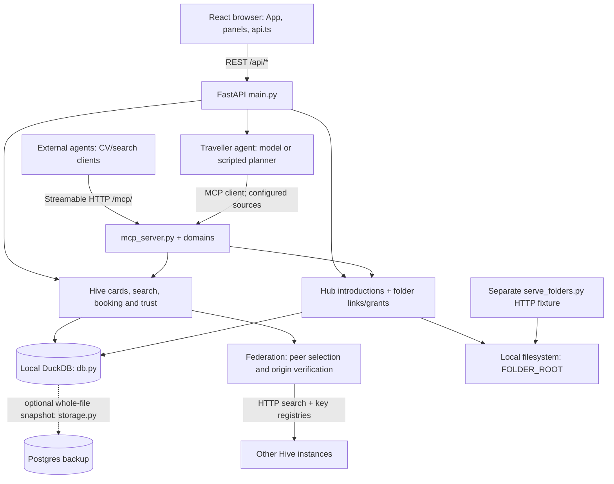

<p align="center">
  <picture>
    <source media="(prefers-color-scheme: dark)" srcset="assets/brand/adobee-hive-wordmark-light.png">
    
  </picture>
</p>

<p align="center"><b>Buzzing with Autonomous Intelligence.</b></p>

<p align="center">Websites are for humans. <b><i>Hives are for agents.</i></b></p>

<p align="center">
  <a href="https://github.com/reactbias/Adobee-Hive/actions/workflows/ci.yml"></a>
  <a href="code/backend/tools/README.md"></a>
  <a href="code/backend/tests"></a>
  <a href="license.txt"></a>
</p>

<p align="center">
  
  
  
  
  <a href="https://reactbias.github.io/Adobee-Hive/"></a>
</p>

Adobee Hive is Team B6's entry for Adobe's **The Post-Website Business** challenge at BaselHack 2026. It answers
one question: when a hotel's, café's or freelancer's **first visitor is an AI agent and not a person on a
website**, how does that business stay found, trusted and bookable — and stay in control of how it is presented?

The answer is not another website. A person or a business keeps its context where it already lives, in its own
folders. A **hub** lists it as **signed JSON** instead of as a page. Hubs **federate**, so one search reaches
several of them. And a match leads to **two agents talking**, with no website in between.

Everything on this page was checked against the code. The gaps are listed too, on
[**LIMITS.md**](documentation/LIMITS.md) — the honest list of what this prototype does not do, which is the page
to read second.

## Links

| What | Where |
| --- | --- |
| **Hosted app** | https://reactbias.github.io/Adobee-Hive/ · one page: [find](https://reactbias.github.io/Adobee-Hive/#find) · [offer](https://reactbias.github.io/Adobee-Hive/#offer) · [network](https://reactbias.github.io/Adobee-Hive/#network) |
| **Hosted backend** | [`/api/health`](https://adobee-hive.onrender.com/api/health) · [REST docs](https://adobee-hive.onrender.com/docs) · [MCP for agents](https://adobee-hive.onrender.com/mcp/) · [discovery document](https://adobee-hive.onrender.com/.well-known/hive.json) |
| Presenter view | [`?demo`](https://reactbias.github.io/Adobee-Hive/?demo) adds the stress test, Simulate 40, the tamper test and the raw MCP exchange |
| Run it yourself | [Five-minute setup](#run-it-locally-in-5-minutes) → app `http://localhost:5173`, REST docs `http://localhost:8000/docs`, MCP `http://localhost:8000/mcp/` |
| Code | [Repository](https://github.com/reactbias/Adobee-Hive) · [Issues](https://github.com/reactbias/Adobee-Hive/issues) · [Pull requests](https://github.com/reactbias/Adobee-Hive/pulls) · [CI and deploys](https://github.com/reactbias/Adobee-Hive/actions) |

Two caveats belong next to those links. **GitHub Pages deploys from `main` and can lag it by a few minutes.** And
the backend is on Render's free tier, which **sleeps after about fifteen idle minutes and takes roughly a minute
to wake**: the first request after a quiet spell can answer `503` and then succeed on a retry. A scheduled
workflow pings `/api/health` every ten minutes to keep it up, but a `503` from either address still means "cold",
not "broken" — load it again before concluding anything. For a reading that cannot be confused with a cold start,
run it locally.

## What it is

Four moves, and nothing in them requires a website.

1. **Your context stays yours.** You point a hub at a folder you already have. The browser reads it locally — it
   is never uploaded — and fills in a **Card** from what it finds. One entity, whether a hotel, an electrician or
   a frontend developer, is one Card: offers, needs, description, bookable units, contact, and the *shape* of the
   folder (every path, its size and its digest) without its contents.
2. **The hub publishes it as signed JSON, not as a page.** Every Card version is Ed25519-signed over canonical
   JSON and gets a verification key pinned in the hub's `/.well-known/hive.json`. An agent checks the signature
   itself, against the key pinned in the Card's **own** hub, so a relaying hub can withhold a Card or delay it and
   can never forge one. Facts expire: a version says how long it holds (90 days here), so a scraped copy goes
   stale on its own.
3. **Hubs federate.** Any town, association or chain runs its own hub. A search carries a **radius** — how many
   hub-to-hub hops it may travel, chosen by the person, capped at three — and every result says which hub carried
   it and through which relay. No single platform owns the front door again.
4. **A match is two agents talking.** The traveller's agent discovers, verifies, compares and books over
   **MCP**. The owner's agent can read and republish its own Card over the same transport. The human sets the
   intent and approves; nothing that commits a person happens without that one click.

Two ideas sit on top. **Open ranking:** a result carries its score breakdown and the reason every other entity was
left out, and placement cannot be bought. **Missed demand:** every request no business could answer is recorded,
so a café learns that agents asked for vegan breakfast before 8 and a street learns what Basel wants that nobody
offers yet — aggregate and anonymous, describing requests and never people. The hub counts *what* was asked,
never *who* asked.

The full argument, including why we think this is where the web goes either way, is in
[**VISION.md**](documentation/VISION.md). The three-minute pitch is [PITCH.md](documentation/PITCH.md).

> On GitHub you find projects to work on. On Adobee Hive, agents find businesses and people to work with.

## What you get out of it

Three people stand around this thing, and each of them gets something they cannot get from a website.

**If you run a small business**, you get a presence that costs one document instead of a site: point a hub at a
folder you already keep, check the Card it drafts, and sign. Agents can then find you, verify your prices against
your own signature and book you, and you keep the guest — there is no aggregator in the middle taking a cut and
owning the relationship. You also learn what you are *missing*: every request the hub could not answer is
recorded, so you see that twelve agents asked for a dog-friendly room this week before you lose the thirteenth.
Edit in plain words — "add sauna, the courtyard double is 165 francs" — read the diff, sign, and the change is
live for every agent at once.

**If you are building an agent**, you get a directory you do not have to scrape. One MCP endpoint, 29 tools,
structured answers: search, fetch a signed Card, check availability, hold a booking, ask for an introduction,
and exchange a consented CV. Your
agent verifies every fact itself against a key published by the Card's own hub, so you are not trusting our
server — and every result carries its score breakdown and the reason each other candidate lost, which is
something a search box has never given you. No key, no contract and no sign-up to try it: point a client at
`/mcp/` and start.

**If you run a hub** — a town, a trade association, a chain — you get the front door back. Admission is yours to
set (`open`, `vetted`, `invite`, `closed`), the search reaches your peers as far as the person asks it to, and a
browser panel shows your queue, your entities, your blocklist and your neighbours. Your peers score you on
whether your claims survived contact with their users, so honest vetting is the cheapest strategy available to
you rather than a favour you do the network.

And in every case: **the person says yes.** Nothing that commits someone — a booking, an introduction, a contact
detail — happens without a human approving it, and they see every call the agent made before they do.

## What works today

Demonstrable now, on a checkout of `main`, and each row says where in the code to check it.

| It does this | Where |
| --- | --- |
| **An agent books a hotel without opening a website**, end to end over MCP: discover, fetch the signed Card, check availability, propose, and book only after a human approves. A critic argues for the strongest alternative from the open ranking and a verifier checks the held booking against the request and the signed Card before you are asked at all | `app/agent.py`, `critic.py`, `second_opinion.py`, `pages/TravellerAgent.tsx` |
| **Federated search with a hop limit and provenance.** A query carries how far it may travel, the time budget it has left and the hubs it has already visited. Every result reports `provenance.path`, `hops`, `origin` and the other routes the same Card arrived by, and every relayed Card is verified against the key pinned in its own hub's registry — a Card that cannot be checked is refused with a reason, never admitted on the carrier's word | `app/federation.py`, [FEDERATION.md](documentation/FEDERATION.md#how-far-to-look-the-radius) |
| **Semantic matching with no API key, no network call and no new dependency** — accent-folded stems, a four-language concept table, German compound splitting and character trigrams above a measured floor. Measured against an answer key of 41 queries, none of which shares a searchable word with its target: **19/41 first and 30/41 in the top three**, against **0/41** for the substring matching it replaced | `app/semantic.py`, [`testdata/`](testdata/README.md) |
| **Two levels of trust, kept apart.** A peer hub's *reputation* is how it has behaved here. Its *calibration* is the signed gap between what it promised at an introduction and what our own person reported after the real meeting (`published − realised`, in tenths of a star, recency-weighted). Lower is better and the sign carries meaning, so a hub that **under-promises scores better** than one that oversells. A hub cannot move it with anything it says about itself, because every input comes from our users | `app/reputation.py`, `calibration.py`, [FEDERATION.md](documentation/FEDERATION.md#two-levels-of-trust) |
| **A folder link, and per-path grants, served over HTTP.** A link is handle to handle and carries no content; a linked peer sees the `shared` files the Card never mentioned; a grant names **one path** and one peer, with no wildcards and not the whole folder; `private` and `hidden` paths are counted and never named, not in a manifest and not in a refusal. Every refusal is the same `404`, so a traversal attempt cannot be told from a typo | `app/folders.py`, [FOLDER_API.md](documentation/FOLDER_API.md) |
| **24 MCP tools over Streamable HTTP**, including an owner's own agent reading, proposing and publishing changes to its own Card without leaving MCP (`hive_owner_card`, `hive_owner_propose`, `hive_owner_publish`, gated by an `X-Owner-Token` header) | `app/mcp_server.py`, [tool table](documentation/ARCHITECTURE.md#mcp-tools-mcp-streamable-http) |
| **Joining a hub is one signed JSON document.** `POST /api/hub/register` runs six checks in order — shape, size, signature, blocklist, availability, invite — stops at the first failure, then applies the hub's admission policy (`open`, `vetted`, `invite` or `closed`). A refusal is an answer with a reason and a next step, not an error. The applicant's keypair is generated in the browser and the private half is theirs to download | `app/registration.py`, [REGISTRATION.md](documentation/REGISTRATION.md) |
| **Running a hub from the browser**: `?admin`, the hub's password for a short-lived session, then the overview, the admission queue, the entity list, the blocklist and the neighbours — plus a honeycomb of this hub and its peers, each edge coloured by that peer's calibration and a blocked peer still drawn and visibly cut | `app/admin.py`, `panels/AdminPanel.tsx`, `panels/NetworkPanel.tsx` |
| **A hub directory and an instance finder**, instances.social style, with the column a Mastodon directory cannot offer: how honest each hub's ratings have turned out to be | `admin.directory`, `panels/InstanceFinder.tsx` |
| Signed rulesets a person picks per search ("Dogs, verified", by a dog owners' club). They only ever narrow, and every answer names the ruleset, its author and what it changed | `app/rulesets.py` |
| Standing requests: when nothing fits, an agent can wait anonymously; the owner sees how many wait for which change, and publishing it sends each one a signed offer | `app/waiting.py` |
| A web scout: when no Card fits, the agent asks what is missing, looks on the public web, verifies each find against the business's own site, and adds it as an **unclaimed** Card that the agent will hand off to but never book | `app/domains/scout.py` |
| Reviews only from a signed booking receipt, and item-level sharing (`public`, `confirm`, `push`, `never`) where the stricter of the item's flag and the entity's default always wins | `app/hive.py`, `sharing.py` |
| Four languages in the browser — English, German (Swiss), French and Italian — and **dark mode that follows the reader's system** unless they choose otherwise | `src/i18n/`, `components/ThemeToggle.tsx` |
| **It all works with no API key.** Without one the agent runs a scripted planner over the same MCP tools and the same approval gate, and owner edits fall back to rules. The demo cannot die for want of a key | `app/agent.py`, `config.py` |

Paths above are relative to `code/backend/` for `app/…`, and to `code/frontend/src/` for `panels/…`,
`components/…` and the rest.

Three peered hubs on one machine, seeded through the real registration endpoint, is one command:
[see below](#three-hubs-on-one-machine).

## What it does not do

A prototype that names its own gaps can be checked; one that does not has to be taken on trust, which is the
opposite of the thing being built here. [**LIMITS.md**](documentation/LIMITS.md) is the full list, every line
checked against the code. The ones a reviewer would find anyway:

- **Nothing crosses a machine yet.** The only folder-link implementation is `LocalFolderLink`, which links two
  folders **on one disk**, inside one process, with its links and grants in DuckDB. No key is exchanged and
  nothing is encrypted. `FOLDER_LINK=claudeconnect` is accepted and falls back to local, with the reason in
  `GET /api/health`. Byte reads are also narrower than the link: `GET /api/folders/file` serves `public` and
  `public-summary` paths only, so a granted `shared` read is one constant away and is not switched on.
- **The hub holds the signing key, including for applicants who brought their own.** A Card carries
  `owner_public_key`, recorded at registration and visible to peers — and **never checked against**. Signatures
  are verified against `trust.public_key`, which `hive.publish` mints and keeps. `custody: "owner"` records who
  applied; it does not mean the owner signs. This is the one gap in the trust story and we say so out loud.
- **A connection requester is an unauthenticated string.** `POST /api/hub/connect` takes a `requester` and
  believes it, and the ledger it writes is what feeds calibration
  ([#158](https://github.com/reactbias/Adobee-Hive/issues/158)).
- **There is no sign-in.** No operator accounts and no owner accounts: `ADMIN_PASSWORD` is one shared secret for
  the whole hub, so an admitted application records `decided_by: "admin"` and nothing about which person decided
  it, and `OWNER_EDIT_TOKEN` is one secret for *every* Card on the hub. Five admin **reads** need no credential at
  all, and one of them — the admission queue — carries applicant details that do not belong in that set. Every
  admin **write** does fail closed.
- **`verification` never rises above `signed`.** The ladder runs `none`, `signed`, `domain`, `identity`, and a
  `dns-txt`, `rel-me` or `email` proof is recorded unverified and raises nothing, so the top two rungs are
  unreachable today.
- **Calibration does not reach the search rank.** A federated result is ranked
  `local_relevance × hub_path_trust × hop_decay`. The sharper measurement orders the hub directory and the
  neighbours table, and is what a person choosing a hub reads — not a factor in that product yet. A hub with
  fewer than three scored introductions reads **unproven** rather than being guessed at, which on a fresh hub is
  most of what the directory shows.
- **There is no second deployed hub.** The hop machinery is real and tested, but the hosted backend has no peers,
  so a search against it stays local whatever the reach control says. Federation is demonstrated with three hubs
  on one machine.
- **Nothing is charged.** A booking says "pay at the property". No payments, and no claiming an unclaimed Card.

All seed businesses and people are fictional. The one exception is a handful of clearly marked **unclaimed**
example cards compiled from public business information — findable, hand-off only, and not evidence of any
owner's endorsement.

## Architecture

A **single-instance Python backend**, not a microservice system. React/Vite/TypeScript is the browser client;
FastAPI serves REST and mounts the MCP Streamable HTTP server; both reach the same core modules and the same local
DuckDB. Domain modules add use cases beyond stays rather than separate databases.



The module-by-module inventory is [ARCHITECTURE.md](documentation/ARCHITECTURE.md). Seven more pictures — a
booking from question to receipt, where the data lives, every door into the hub, a federated search, and the
folder handshake — are in [documentation/DIAGRAMS.md](documentation/DIAGRAMS.md), with five hand-drawn ones in
[documentation/diagrams/](documentation/diagrams/README.md). A test fails CI if a new module, endpoint, MCP tool
or panel is missing from either page.

<details>
<summary><b>Boundaries to keep straight</b> — seven distinctions that save an afternoon each</summary>

<br>

- **Index versus files.** A Card is JSON with offers/needs, descriptions and optional folder metadata. Original
  PDFs, images and other bytes stay on disk; DuckDB and Postgres are not a file-sync service.
- **Search versus models.** `hive.discover()` combines explicit constraints, literal matching and the offline
  similarity provider. It needs no model key and no vector database; the optional embedding provider is
  deliberately not implemented, so `/api/health` reports `semantic: offline` with or without a key.
- **Peers versus booking providers.** `HIVE_PEER_URLS` seeds the hub's peer table for HTTP federation, which the
  operator can then change at runtime. `HIVE_MCP_URLS` configures the traveller agent's MCP sources. Neither
  setting discovers a hotel provider from folder text.
- **Signatures versus identity.** Signing detects tampering. It is not verified real-world business identity, and
  it is not owner-held signing custody.
- **Reputation versus calibration.** Two measurements, two modules that never read each other, because a hub can
  be reliable and dishonest, or honest and slow.
- **Persistence versus production durability.** DuckDB is the working database; an optional `DATABASE_URL`
  restores a missing local file and snapshots the whole file to Postgres. Holds, rate counters, admin sessions and
  peer reputation are process-local. Use one backend worker.
- **Admin versus ownership.** Operator writes fail closed without configured admin credentials. Owner checks are
  separate. Shared operator credentials are not individual owner accounts.

</details>

### The two journeys

**Booking:** browser REST request → traveller agent → MCP discovery, Card and availability → server-held
`hive_book` proposal → **explicit human approval** → the original configured MCP source → booking and signed
receipt. The critic is deterministic; the second opinion can use a model or a rule check. A hold is neither an
inventory reservation nor a guarantee against later price or terms changes. An external client calling `hive_book`
directly must implement its own approval policy.

**Candidate and CV:** external system → MCP discovery → signed person Card and its `structure` → introduction and
link metadata → authorised REST file access → its own extraction. Link credentials and explicit per-path grants
gate every read, on the hub's disk. A returned path or an open link is not blanket permission to read private
bytes.

## Run it locally in 5 minutes

You need **Git, Python 3.12, Node 22 and npm**. No model key, no Postgres and no external service is required for
local discovery or the scripted booking workflow.

```bash
git clone https://github.com/reactbias/Adobee-Hive.git
cd Adobee-Hive
cp code/.env.example code/.env
cd code/backend
python3.12 -m venv .venv
source .venv/bin/activate
python -m pip install -r requirements.txt -r requirements-dev.txt
```

On Windows PowerShell: `Copy-Item code/.env.example code/.env`, `py -3.12 -m venv .venv` and
`.venv\Scripts\Activate.ps1`. For a predictable no-key run set `LLM_PROVIDER=offline` in `code/.env`. Keep
`DATABASE_URL` empty for an isolated local database.

**Terminal A**, from `code/backend` with the venv active:

```bash
python -m uvicorn app.main:app --host 127.0.0.1 --port 8000 --env-file ../.env
```

**Terminal B**, from the repository root:

```bash
cd code/frontend
npm ci
npm run dev
```

Open http://localhost:5173. The build's own hub is selected by default and **Change Hive** opens the finder.
`#find`, `#offer` and `#network` switch screens; `?demo` adds the presenter controls; `?admin` opens
administration and needs locally configured admin credentials. The status strip reports backend reachability
separately from the configured planner mode — "model configured" is not a successful quota check. Startup seeds
fictional hotels and the unclaimed public-info example cards.

Vite proxies `/api`, `/mcp` and `/.well-known` to `http://localhost:8000`; set `VITE_DEV_BACKEND` for a backend on
another port. `VITE_API_URL` is only the build-time default for which hub a visitor talks to before they pick
one — a selected hub's URL overrides it, per call.

<details>
<summary><b>Configuration that matters</b> — the eight settings worth knowing before the full list in <code>app/config.py</code></summary>

<br>

| Setting | Meaning |
| --- | --- |
| `LLM_PROVIDER`, `OPENAI_API_KEY`, `ANTHROPIC_API_KEY` | Optional planner provider and keys; keep secrets in the gitignored `code/.env`. The scripted planner works without them |
| `DUCKDB_PATH`, `DATABASE_URL` | Local database file (default `code/backend/data/abh.duckdb`) and optional Postgres snapshot destination |
| `SEED_ON_EMPTY` | Seed the small default demo when the card database is empty |
| `HIVE_HUB_ID`, `HIVE_PEER_URLS` | This hub's identity and its initial HTTP peers; peers thereafter live in the operator-managed table |
| `HIVE_MCP_URLS` | Operator-configured MCP sources for the booking agent, not arbitrary discovered provider URLs |
| `FOLDER_ROOT`, `FOLDER_LINK` | Local vault root and folder implementation; `local` is the working default |
| `ADMISSION_POLICY` | Default `vetted`, so a valid registration can stay pending. A pending application is not a searchable Card |
| `ADMIN_PASSWORD`, `ADMIN_TOKEN`, `OWNER_EDIT_TOKEN`, `DEMO_RESET_TOKEN` | Separate operator/session, owner-write and reset credentials. A deployed hub should set `OWNER_EDIT_TOKEN` |

`code/.env.example` is a starting subset; `app/config.py` holds every setting. Never commit `.env`, DuckDB files,
keys or personal data.

</details>

### Three hubs on one machine

Federation needs more than one hub, so there is a launcher for it. After the setup above, from the repository
root:

```bash
PORT_APP=8540 PORT_A=8520 PORT_B=8521 PORT_C=8522 ./lan.sh up
```

It seeds fictional vaults through the real registration endpoint, starts Basel, Zürich and Bern with separate
databases, and builds and proxies the app. **Read the URLs it prints** — they are the addresses to use, including
the LAN address for a phone on the same wifi, which is why none is written down here. Pin unused ports if another
stack is already running. It needs the venv at exactly `code/backend/.venv`.

One timing note, because it is easy to misread as a bug: each hub asks its peers who they are at startup, before
the corpus is seeded. **Poll `GET /api/hub/directory` until a peer's `entities` is non-zero before your first
federated search**, or the relayed cards fail verification and the carrier is charged for it for the life of the
process. [DEVELOPER.md](documentation/DEVELOPER.md#three-hubs-on-one-machine-lansh) and
[LIMITS.md](documentation/LIMITS.md#running-a-hub) have the detail.

## Integration contracts

### REST, for a UI or a JSON search

```bash
curl -fsS http://localhost:8000/api/health
curl -fsS http://localhost:8000/.well-known/hive.json
curl -fsS -G http://localhost:8000/api/hive/discover \
  --data-urlencode 'query=quiet dog-friendly hotel near Basel SBB under CHF 200' \
  --data-urlencode 'kind=hotel' --data-urlencode 'radius=0'
curl -fsS http://localhost:8000/api/hive/cards/hotel-rheinblick
```

Live schemas are at `/docs` and `/openapi.json`, and `GET /api/hub/registration` publishes the admission policy
and the exact field ceilings, so read those from the hub rather than hard-coding them.

<details>
<summary>Four things that catch every new consumer</summary>

<br>

- `offers` and `needs` are the index; `kind` is only a filter, and `looking_for=offers|needs|any` chooses which
  side of the market to search. A hub carries a tavern, a developer and an electrician side by side, so nothing
  downstream may assume a narrow domain.
- Hard constraints decide **eligibility**, and an entity the ask earned nothing from is left out, so `matched: 0`
  means nothing answered. Pass `include_irrelevant=true` for the full ranking, and read `score_breakdown`, `why`
  and `excluded`.
- A local match is a summary — fetch its Card by id. A **federated** match already includes its signed `card`, so
  do not ask the answering hub for a remote id. Show `provenance.path` origin-first; a user must never be unable
  to tell whose directory answered.
- An unknown card id returns `400`, not `404`: every `HiveError` maps to `400`.

</details>

The full written spec, with real payloads and the scoring breakdown, is
[SEARCH_API.md](documentation/SEARCH_API.md).

### MCP for an external agent

Use **Streamable HTTP**, not a plain GET and not an older SSE tutorial; the hub advertises `<backend>/mcp/` in its
discovery document. With this repository's pinned `mcp==2.3.0`:

```python
import asyncio
from mcp import Client

async def main():
    async with Client("http://localhost:8000/mcp/") as client:
        print([tool.name for tool in (await client.list_tools()).tools])
        result = await client.call_tool(
            "hive_discover", {"query": "quiet", "kind": "hotel", "radius": 0}
        )
        print(result.structured_content)
        card = await client.call_tool("hive_get_card", {"card_id": "hotel-rheinblick"})
        print(card.structured_content)

asyncio.run(main())
```

Call `list_tools()` for the live schemas; the groups are `hive_discover`/`hive_get_card`,
`hive_check_availability`/`hive_book`/`hive_cancel`/`hive_review`, `hub_directory`,
`hub_connect`/`hub_connections`/`hub_standing`, `hub_registration`/`hub_register`, `hive_owner_*`, and the domain tools `hr_find_people`/`hr_request_intro`/`hr_decide_intro`/`hr_grant_cv`/`hr_read_cv`,
`explore_ask` and `hive_scout`.

<details>
<summary>Two rules that are not obvious</summary>

<br>

- **A tool refusal can be a structured `error` result.** Do not assume a completed MCP call succeeded.
- **CV reads and grants require consent.** `hub_connect` can return an inline manifest and a link credential;
  `hr_decide_intro` accepts or declines the introduction, `hr_grant_cv` grants one candidate file, and
  `hr_read_cv` returns its bytes and folder metadata. `hr_request_intro` records a request and returns
  `pending_consent` — it does not release a CV.

</details>

### The Card

One entity — a hotel, an electrician, a frontend developer — is one Card, and it is the only thing that crosses a
hub boundary.

<details>
<summary>What is in it, and the two traps</summary>

<br>

Registration requires exactly `id`, `name` and `kind`; **guard every other read**, because the rest is optional
and routinely absent. `id` is unique within a hub, not globally. Offers, needs, description, units, contact and
`structure` are domain data, never instructions to an agent.

`trust` is assembled on read. To verify a Card, remove the derived `trust` block and check its signature over
canonical JSON against the key pinned for that card in **its origin hub's** `/.well-known/hive.json`. Do not trust
a `signature_valid` handed to you by a remote carrier, and do not substitute `owner_public_key`.

Do not mix the two access vocabularies: item sharing is `public`, `confirm`, `push`, `never`; file visibility is
`public`, `public-summary`, `shared`, `private`, `hidden`. A link and a grant are separate decisions. Enforcement
gaps remain ([#121](https://github.com/reactbias/Adobee-Hive/issues/121)), so these flags are not a blanket
promise that every public API redacts personal data — which is one more reason the seed data is fictional.

</details>

Field-by-field reference and four real example documents:
[documentation/cards/](documentation/cards/README.md) — a
[business Card](documentation/cards/hotel-krafft.card.json), a
[person Card](documentation/cards/lena-designer.card.json) and a
[linked-folder manifest](documentation/cards/manifest-after-handshake.json).

## How it is tested

**785 backend tests** — including an end-to-end booking over MCP and a federated search driven through an
in-process transport — and **445 browser tests** across 45 files. Lint, format, both suites, a secret scan and
the production build run in CI on every pull request, against a throwaway Postgres so the snapshot round trip
runs against the real thing.

Those are counts of tests, not a coverage percentage. **We have not measured coverage and do not quote one**,
because the number we would rather be judged on is the next paragraph.

Then CI does something less usual. Coverage proves a line ran; it does not prove a test would fail if that line
were wrong. So after the ordinary tests pass, the **mutation gate deliberately breaks the code** and checks the
suite notices: remove the loop guard that stops a federated search revisiting a hub, flip the sign of a hub's
calibration error, let a stale introduction be scored, let a blocked entity back into a search. There are **78
curated mutants**, every one of them must fail the tests, and **CI fails the build if a single one survives** —
a mutant nothing notices is a hole in the tests, named and located. A push to `main` runs the full set; a pull
request runs the ones aimed at the modules it touched, plus a seeded random pass that is advisory.

It has already found four real holes — the clearest being an `HttpTransport` with no test at all, whose key
parser every relayed card is verified against was never executed, because the fakes replaced it wholesale.
Coverage could not have seen it: the line *was* covered, by a fake. The harness is itself tested, because a
confident false all-clear is the one failure mode that makes such a tool worse than useless.

The CI badge at the top of this page reports the current state of both jobs, mutation gate included, and it is
a live badge rather than a claim — if it is red, a mutant is surviving or a test is failing right now.

How to run it, and what each mutant protects: [code/backend/tools/README.md](code/backend/tools/README.md).

## Where to read what

| Question | Page |
| --- | --- |
| What is this, and why is it plausible? | [VISION.md](documentation/VISION.md) · [PITCH.md](documentation/PITCH.md) |
| **What does it not do?** | [LIMITS.md](documentation/LIMITS.md) |
| How does a search reach another hub, and how is a hub measured? | [FEDERATION.md](documentation/FEDERATION.md) |
| How does a business or a person join one? | [REGISTRATION.md](documentation/REGISTRATION.md) |
| What is in the Card, and what does a search return? | [cards/](documentation/cards/README.md) · [SEARCH_API.md](documentation/SEARCH_API.md) |
| How does a folder link work, byte by byte? | [FOLDER_API.md](documentation/FOLDER_API.md) · [FOLDERS.md](documentation/FOLDERS.md) |
| How do I run it, and what does each part do? | [documentation/DEVELOPER.md](documentation/DEVELOPER.md) · [ARCHITECTURE.md](documentation/ARCHITECTURE.md) · [documentation/DIAGRAMS.md](documentation/DIAGRAMS.md) |
| What is deployed, and what does it cost? | [DEPLOY.md](documentation/DEPLOY.md) |
| What is the threat model? | [SECURITY.md](SECURITY.md) |
| The challenge brief and the judging criteria | [CHALLENGE.md](documentation/CHALLENGE.md) |
| Name, logo, voice, colour | [BRAND.md](documentation/BRAND.md) |

## Contributing

Read [CONTRIBUTING.md](CONTRIBUTING.md) for the workflow and the file-ownership map, and
[AGENTS.md](AGENTS.md) if you are a coding agent. Tests come first, commits are small and conventional, every
user-facing string ships in four languages in the same pull request, and the demo must keep working with no API
key at all.

Team B6's own lanes, work queue and hackathon operating notes live in
[documentation/FIRST_HOURLY.md](documentation/FIRST_HOURLY.md); who we are is in
[documentation/TEAM.md](documentation/TEAM.md).

## Licence

**MIT**, an OSI-approved licence — the full text is in [license.txt](license.txt), copyright © 2026 Team B6,
BaselHack 2026.
